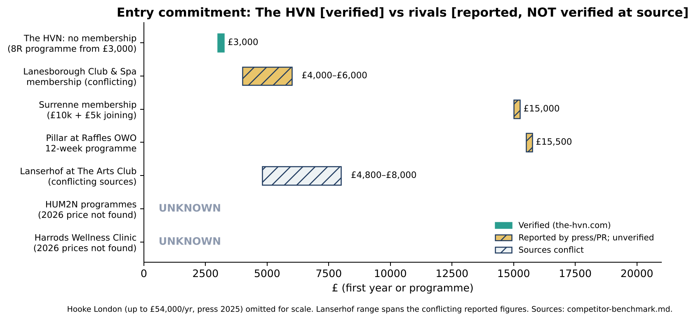
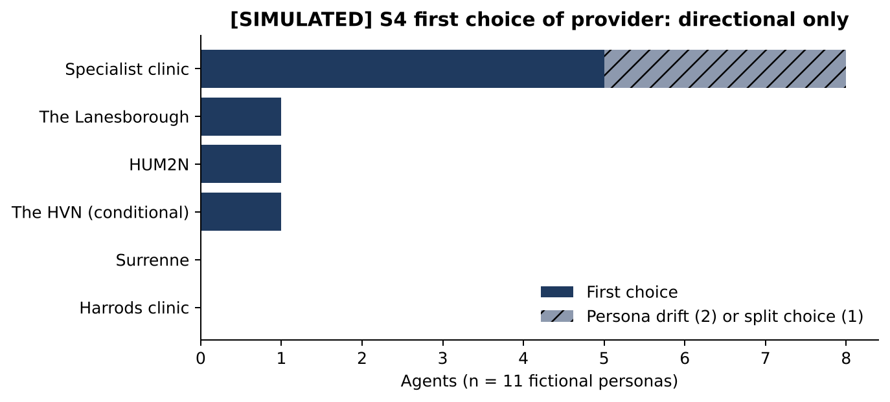

# The HVN: Competitor Benchmark

**Version:** 1.0, 15 October 2026 · **Data:** `evidence/competitor-benchmark-2026-10-15.csv` (17 providers) · **Supersedes for decisions:** the price columns of `competitors.md` (which stays as the Phase 0 source record)
**Contains no simulated content** except §5, which is labelled.

## 1. Verification rules (read first)

| Status | Meaning | Use |
|---|---|---|
| **VERIFIED** | Loaded directly from the provider's own website or the regulator's register by this study | Can support a decision as of the date shown |
| **REPORTED** | Found only in press, a press release or a directory, or via a search engine's summary of a primary page | Context only. **Treated as Unknown for decisions** |
| **UNKNOWN** | Not found, conflicting or outdated | Must be checked at source before use |

**Result of the 15 October 2026 check:**
- Every competitor website, cqc.org.uk and asa.org.uk were blocked from this environment (proxy refusal; direct fetch failed).
- Ten web searches were run to see whether reported figures still appear in 2026 sources.
- **No competitor price, membership or regulatory fact is verified at source.** As you asked, all of them are marked **Unknown**. The reported figure is shown beside each one, with its source and date, only so that someone with normal browser access knows what to check.
- **The HVN's own CQC inspection status is also Unknown** (`report-audit.md` U1).

## 2. Benchmark table

| Provider | Tier | Model (reported) | Entry price | Membership / commitment | Regulator (CQC) | Latest source | Confidence |
|---|---|---|---|---|---|---|---|
| **The HVN** | Subject | Doctor-led integrated clinic, pay per visit | **VERIFIED:** consultations £175 / £350 / £400; lab profiles £180–£750; IV £275–£425; NAD £350–£800; 8R from £3,000 | **VERIFIED:** no membership on the website (confirmed by you) | **UNKNOWN** (badge unlinked; v1 search said "registered, not yet inspected") | the-hvn.com, 15 Oct 2026 | High (site) |
| Surrenne (Maybourne) | 1 Direct | Members-only club, longevity lounge | UNKNOWN (not reported) | **UNKNOWN**; reported £10,000/yr + £5,000 joining, cap ~100 | UNKNOWN | 2026 trade guide repeating 2024 press | Low–Medium |
| The Lanesborough Club & Spa | 1 Direct | Hotel members' club and spa | UNKNOWN; reported facial £500, day pass £150 (older) | **UNKNOWN (sources conflict)**; reported from £6,000 / £4,000 overseas; also ~£3,500 and £6,600 + £2,000 | UNKNOWN | Undated magazines | Low |
| Wellness Clinic at Harrods | 1 Direct | Independent operators under one roof | UNKNOWN; reported facial consultation £195, Profhilo from £800 (pages ~1,350 days old) | Per treatment (reported) | UNKNOWN (operator-specific) | 2017–2023 | Low |
| HUM2N | 2 Longevity | Physician-led longevity; Six Senses clinic from Jun 2026 | **UNKNOWN**; v1 reported NAD £295–£450 (not found in 2026 search) | **UNKNOWN**; v1 reported £495–£695/month + one-off fee | UNKNOWN | Jun 2026 (opening only) | Low |
| Lanserhof at The Arts Club | 2 Longevity | Medical gym + clinic | UNKNOWN; 2022 list: consultations £390 / £550 | **UNKNOWN (sources conflict)**; £6,500 + £1,500 vs ~£3,200 + £1,600 assessment | UNKNOWN | 2022–2023 | Low |
| Pillar at Raffles OWO | 2 Longevity | Hotel wellbeing club | UNKNOWN; reported **12-week programme from £15,500** (Jan 2026) | UNKNOWN; reported 3-month membership with upgrade; £6,250/yr (2023) | UNKNOWN | Official press release, Jan 2026 | Medium (most recent) |
| Hooke London | 2 Longevity | Diagnostics-led membership | UNKNOWN; reported one-day investigation up to £15,000 | UNKNOWN; reported up to £54,000/yr | UNKNOWN | Jan 2025 | Low–Medium |
| The Online GP | 2 Longevity | Diagnostics-led testing | UNKNOWN; v1 reported panel from £645 (not found in 2026 search) | UNKNOWN | UNKNOWN | v1 index | Low |
| Clinique La Prairie partners | 2 Longevity | Swiss brand in Knightsbridge hotels/Harrods | Not published | — | UNKNOWN | 2023 | Low |
| Taktouk Clinic | 3 Aesthetics | Doctor-led aesthetics, Sloane St | UNKNOWN (price on request, directory) | — | **REPORTED:** Good overall, inspected Mar 2023; injectables outside CQC scope (CQC page via search) | May 2023 | Medium |
| IV Drip Clinic London | 3 IV/HBOT | IV and HBOT | UNKNOWN; reported NAD from £350 | — | UNKNOWN | Directory | Low |
| REVIV at Harrods | 3 IV | IV concession | UNKNOWN | — | ASA ruling against REVIV UK (Dec 2023) on IV claims [REGULATOR, via search] | Dec 2023 | Medium (ruling) |
| Menopause Clinic London | 3 Women's health | Menopause consultations | UNKNOWN; directory listings £185–£275 | — | UNKNOWN | 2026 directory | Low |
| Zita West | 3 Fertility | Fertility acupuncture | UNKNOWN; directory: from £90/session | — | UNKNOWN | Undated | Low |
| Six Senses Place | 4 Substitute | Hotel members' club (hosts HUM2N) | UNKNOWN | UNKNOWN (fees not reported) | n/a | Mar–Jun 2026 | Medium (existence) |
| Four Seasons Park Lane | 4 Substitute | Spa and wellness memberships | UNKNOWN | UNKNOWN (fees not reported) | n/a | 2026 PR | Medium (existence) |

## 3. What can be said with confidence

| # | Benchmark finding | Basis | Confidence |
|---|---|---|---|
| B1 | **The HVN publishes per-service prices at a level of detail that no Tier 1 rival is reported to match** (148 pages, 342 price points). Rivals are reported to use membership or price-on-request models. | The HVN side verified; rival side reported only | High (HVN) / Low (rivals) |
| B2 | **The HVN has no published route between a ~£750 entry step and an unpriced plan.** The only reported recent programme anchor in the market is **£15,500 for 12 weeks** (Pillar, official PR, Jan 2026). The HVN's own retired 360° programme was £14,500 for 16 weeks (v1; now 404). | Verified (HVN); reported (Pillar) | High / Medium |
| B3 | **The HVN's NAD and IV prices sit inside the reported London range** (£295–£450 for NAD at HUM2N in v1; from £350 at IV Drip Clinic). Not a price outlier, but rival figures are unverified. | Reported | Low |
| B4 | **Membership is the reported model at most Tier 1–2 rivals** (Surrenne, Lanesborough, Lanserhof, Pillar, Hooke; HUM2N monthly). The HVN is pay-per-visit. **Whether buyers see that as an advantage or as "less exclusive" is untested** (`validation-plan.md` H06). | Reported (rivals); verified (HVN) | Low–Medium |
| B5 | **A nearby aesthetics specialist publicly shows a CQC "Good" rating** (Taktouk, inspected 2023, per CQC pages via search). The HVN cannot show a rating today and its status is unverified. | Regulator page via search | Medium |
| B6 | **New hotel-based longevity supply arrived in 2026**: HUM2N at Six Senses London (June) and Four Seasons memberships. | Trade press / official PR (existence only) | Medium |
| B7 | **Women's-health and fertility specialists are reported at lower entry prices for single needs** (£185–£275 menopause consultations; fertility acupuncture from £90). The HVN's equivalent entry points are £200 (acupuncture) and £350 (Discovery). | Directory (rivals); verified (HVN) | Low |

## 4. Positioning map [HYPOTHESIS]

| Dimension | The HVN (verified facts) | Where rivals are reported to sit | Implication [H] |
|---|---|---|---|
| Access model | Pay per visit; no membership | Membership clubs (Tier 1–2) | Distinctive; value unproven |
| Price transparency | Very high for single services; **none** for plans | Mostly membership fees or price on request | The HVN's strongest *verified* differentiator, undercut by the plan-level gap |
| Clinical breadth under one team | Doctors, TCM, osteopathy, nursing, diagnostics | Harrods: several separate operators; clubs: partner clinics | "One coordinating team" is a plausible advantage for multi-need clients |
| Verifiable quality signal | CQC badge (unlinked); status unknown; reviews widget without visible rating | Taktouk: CQC Good (reported); clubs rely on brand and hotel | Gap that The HVN can partly close (R05, R13, R21) |
| Setting and belonging | Knightsbridge clinic; Hydrobed; rituals | Heritage hotels, members' clubs | Rivals likely stronger on status and belonging |
| Single-need depth | Women's-health doctor, TCM content; **page defects** | Specialists (menopause, fertility) | Must fix W1 before competing (R01, R17) |

## 5. How simulated buyers chose [SIMULATED, directional only]

In S4, 11 fictional LLM personas were asked which provider they would choose. They are **not customers**. The seed emphasised "no membership" and "not yet inspected", and two personas drifted off-brief (`report-audit.md` D2–D4).

Use this only to decide **what to test**: whether multi-need, time-poor clients value one coordinating team (one agent chose The HVN on that basis), and whether single-need clients default to specialists.

## 6. How to make this benchmark decision-grade

1. **Allow or use normal browser access** to: `surrenne.com`, `lanesboroughclubandspa.com`, `harrods.com`, `hum2n.com`, `theartsclub.co.uk`, `raffles.com`, `hookelondon.com`, `theonlinegp.com`, Taktouk Clinic's site, `cqc.org.uk`, `asa.org.uk`.
2. Record each fact with the URL, date and a screenshot. Update the CSV's status from UNKNOWN to VERIFIED only after that check.
3. **Do not mystery-shop or contact competitors** without your approval. If approved, use only public enquiry channels and never misrepresent identity for clinical services.
4. Repeat quarterly (R24).

## 7. Sources (15 Oct 2026 checks added to `evidence/sources.md` §C–D)

- The HVN: live crawl and re-check, 15 Oct 2026 (`evidence/`).
- Surrenne:
  - [Maybourne launch PR (Apr 2024)](https://www.maybourne.com/globalassets/press-releases/pdfs/surrenne_-launch-press-release_april-2024.pdf)
  - [Globetrender (Feb 2024)](https://globetrender.com/2024/02/19/surrenne-is-a-next-gen-longevity-spa-in-london/)
  - [Gentleman's Journal 2026 guide (DE)](https://www.thegentlemansjournal.com/de/article/die-luxuriosesten-fitnessclubs-in-london-2026/)
  - [Sotheby's Realty journal](https://sothebysrealty.co.uk/the-journal/most-expensive-gyms-in-london)
  - [Yahoo AU](https://au.news.yahoo.com/inside-most-expensive-gyms-london-100054338.html)
- Lanesborough:
  - [Fabric Magazine](https://fabricmagazine.co.uk/style-and-wellbeing/join-the-club/)
  - [Diplomat Magazine](https://diplomatmagazine.com/the-lanesborough-club-spa/)
- Harrods:
  - [Attractions Management (2017)](https://www.attractionsmanagement.com/attractions-news/Harrods-Wellness-Clinic-aesthetic-dermatology-spa/332097)
  - [REVIV, Business Wire (2022)](https://www.businesswire.com/news/home/20221219005425/en/REVIV-Launches-an-Opulent-New-Clinic-in-Harrods-and-a-First-in-an-Exclusive-IV-Therapy-Infusion)
- HUM2N: [Spa Business (12 Jun 2026)](https://www.spabusiness.com/wellness-news/HUM2N-opens-longevity-clinic-at-Six-Senses-London/363082)
- Lanserhof:
  - [The Week](https://www.theweek.co.uk/102929/a-gym-like-no-other-the-lanserhof-at-the-royal-arts-club)
  - [Vingt Sept (2022)](https://www.vingtseptmagazine.com/post/the-lanserhof-at-the-arts-club-the-detox-spa-the-a-list-trust)
- Pillar:
  - [Press release via Journal des Palaces (2026)](https://www.journaldespalaces.com/en/pressrelease-76619-pillar-wellbeing-announces-three-month-transformation-programme-at-raffles-london-at-the-owo.html)
  - [Globetrender (6 Jan 2026)](https://globetrender.com/2026/01/06/raffles-london-15k-transformed-three-months/)
- Hooke: [Spear's (Jan 2025)](https://spearswms.com/luxury/health-wellness/hooke-health-clinics-super-rich-live-longer-longevity-wellness/)
- Taktouk:
  - [CQC location reports (via search)](https://cqc.org.uk/location/1-11010496756/reports)
  - [Consentz](https://www.consentz.com/directory/clinics/london/clinic/taktouk-clinic/)
- Specialists:
  - [TreatCompare](https://www.treatcompare.com/providers/menopause-clinic-london)
  - [WhatClinic](https://www.whatclinic.com/fertility/uk/london/zita-west)
- Regulators:
  - [ASA IVNT guidance](https://asa.org.uk/advice-online/healthcare-intravenous-nutritional-therapy.html)
  - [ASA ruling, REVIV UK Ltd](https://www.asa.org.uk/rulings/reviv-uk-ltd-a19-562605-reviv-uk-ltd.html)
- Substitutes:
  - [Luxury Travel Advisor (Mar 2026)](https://www.luxurytraveladvisor.com/hotels/six-senses-london-opens-whiteley)
  - [Four Seasons press (2026)](https://press.fourseasons.com/london/hotel-news/2026/spa-and-wellness-memberships)
