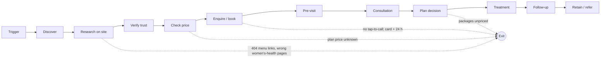

# The HVN: Customer Journey Map (awareness → booking → consultation → treatment → retention)

**Version:** 1.0, 15 October 2026
**Basis:**
- **[V]** live website crawl, re-checked 15 Oct 2026;
- **[R]** press or directories;
- **[S]** MiroFish simulations (fictional agents, not customers);
- **[H]** analyst hypothesis;
- **[?]** unknown, because no data was available.

> **Read first.** This study had **no access to The HVN's analytics, booking system (Pabau), CRM, reviews or staff**. Everything before the booking button is mapped from the live website. **Everything after it** (pre-visit, consultation, treatment, follow-up and retention) is mostly **unknown** and is marked as such, not filled in from simulation.

## 1. Journey overview

## 2. Stage-by-stage map

### Stage 1: Trigger
- **Customer question:** "Something is wrong, or I want to stay well. Who can help?"
- **Typical triggers [H]:**
  - exhaustion or poor sleep;
  - a skin concern;
  - peri/menopause symptoms;
  - fertility treatment;
  - an upcoming event;
  - longevity curiosity;
  - a short London visit.

  The HVN publishes a concern page for each [V].
- **Verified defects:** none.
- **Unknowns [?]:**
  1. Which triggers actually bring clients, and in what proportions (Search Console queries, enquiry log).

### Stage 2: Discover
- **Touchpoints:**
  - Google search, including 30 blog posts and concern pages [V];
  - press coverage (Forbes, Condé Nast Traveller, City A.M. and others; logos on 157 pages) [V];
  - hotel concierges and personal assistants [H];
  - word of mouth [H];
  - social media [?].
- **Verified defects:**
  1. No MedicalClinic/LocalBusiness structured data (no address, hours or geo markup) [V, W9].
  2. Generic women's-health titles ("Menopause - The HVN") [V, W1].
  3. The search-visible site description says "London's leading wellness & longevity clinic", an unsubstantiated superlative [V, W4; `report-audit.md` X1].
- **Unknowns:**
  1. Traffic sources and the queries that drive bookings.

### Stage 3: Research on the website
- **Touchpoints:** home page, 150+ service pages, concern pages, About, team page [V].
- **Verified defects:**
  1. Unclear category. The home H1 reads "HOW THE HVN CAN HELP", while the Contact and Booking titles say "Skin & Hair" [V, W5].
  2. The "Clinical Treatments" and "Holistic Rituals" menu links return 404 on every page [V, W2].
  3. The Menopause, PCOS and PMDD pages list acne treatments [V, W1; still live 15 Oct].
  4. Programme pages return 404; the functional-medicine link lands on an unfinished page [V, W3].
- **Simulated signal:**
  1. "Spa, clinic, longevity or aesthetics? Can't tell." [S: S1 run 2, S2a interviews]

### Stage 4: Verify trust
- **Customer question:** "Who will treat me, are they qualified, and is this place regulated and reputable?"
- **Touchpoints:**
  - team page;
  - the practitioner strip on every page;
  - the CQC badge;
  - the Google reviews widget (157 pages);
  - press logos [V].
- **Verified defects:**
  1. The same four-name practitioner block appears on every page, so no page says who performs that treatment [V].
  2. The CQC badge is an image linked to nothing (0/212) [V].
  3. The review rating and count are not in the page HTML [V].
- **Simulated signals:**
  1. "Who will actually treat me?" (all five full runs).
  2. "Registered ≠ inspected; link it."
  3. "Show the evidence for IV/NAD claims."
  4. Superlatives read as slogans.

  All four were partly primed by the seed (`report-audit.md` D5).
- **Unknowns:**
  1. The HVN's actual CQC status and regulated activities [?, U1].

### Stage 5: Check price
- **Touchpoints:** service pages (prices on ~98% of them), consultations page, 8R page, terms [V].
- **Verified defects:**
  1. Nothing after the ~£750 entry step is priced except 8R "from £3,000"; functional-medicine packages are unpublished [V, W3/W8].
  2. Prices conflict between pages: NAD £375 vs £350; fertility acupuncture from £200 vs £270/£300 [V].
  3. A fee credit is stated only for the £350 Discovery Consultation (£100), not for the £175 or £400 consultations [V].
  4. The acupuncture course price (from £1,620) doesn't say how many sessions it includes [V].
- **Simulated signals:**
  1. "Give me a total or range in writing before I pay a consultation fee" (primed in S2a).
  2. "Is the first fee credited?"
  3. Summing every listed price into a "visible floor" of £2,675.
  4. A 12-month total as the decision metric (S2b).
- **Unknowns:**
  1. How many visitors drop out over price, compared with other reasons.

### Stage 6: Enquire or book
- **Touchpoints:**
  - a Pabau online-booking link on every page;
  - a separate acupuncture booking page;
  - concierge email;
  - two phone numbers;
  - WhatsApp, mentioned on 18 pages [V].
- **Verified defects:**
  1. Tap-to-call (`tel:`) on only 1 of 212 pages [V, W10].
  2. Two different phone numbers are published [V].
  3. The terms require a card to confirm and 24 hours' notice to cancel, but the charge in pounds isn't stated on the site [V].
- **Simulated signals:**
  1. "Show the cancellation charge in £ next to the button."
  2. "I'd book only if a doctor calls back the same day." (single run)
- **Unknowns:**
  1. Booking steps, deposit and mobile usability (Pabau was blocked; NEEDS TESTING).
  2. Response time to enquiries.

### Stage 7: Pre-visit
- **Known:** IV bookings include "a brief 10 minute consultation with one of our doctors" [V], a genuine safeguard.
- **Verified defects:**
  1. No public explanation of what happens before an IV: assessment, contraindications, who prescribes, doses [V].
- **Unknowns:**
  1. Confirmation, reminders and intake forms.
  2. Consent and medical-history process.

### Stage 8: Consultation (£175 aesthetic · £350 Discovery or nutrition · £400 8R)
- **Verified defects:**
  1. The Discovery Consultation's £100 credit only applies to "Functional Medicine Packages", which are not published [V].
- **Simulated signals:**
  1. Clients want a written summary: plan, total, and what is *not* recommended (S1 run 2, S2b).
- **Context [R]:** one June 2025 personal blog describes a skin-analysis result later disputed by a dermatologist and a sense of being upsold. This is a single anecdote, not a pattern.
- **Unknowns:**
  1. What a consultation includes and produces (a written plan?).
  2. Who conducts each type.
  3. The consultation-to-plan conversion rate.

### Stage 9: Plan and purchase decision
- **Verified defects:**
  1. Plans and packages are unpriced [V].
  2. Retired programme URLs, which press and search may still point to, return 404 [V].
- **Simulated signals:**
  1. Paying per session with a clear plan beats a large upfront package (S2a).
  2. A starter bundle only works if the follow-on costs sit on the same page (S2b; hypothetical offer).
- **Unknowns:**
  1. Plan acceptance rate.
  2. Average plan value and mix.

### Stage 10: Treatment
- **Unknowns:**
  1. Delivery quality and consistency.
  2. Clinical outcomes and adverse events.
  3. Client satisfaction.

  No data was available. Do **not** substitute simulation here.

### Stage 11: Follow-up and results
- **Known:** blood profiles offer a £150 doctor follow-up call [V].
- **Verified defects:**
  1. No published follow-up or retest pathway for other services [V].
- **Unknowns:**
  1. Retest cadence.
  2. How results are communicated.

### Stage 12: Retain and refer
- **Model:** pay per visit; no membership; acupuncture courses [V].
- **Simulated signal:**
  1. For the holistic persona, a calm room and being listened to drive return visits (S2a A9).
- **Unknowns:**
  1. Repeat-visit rate.
  2. Review rating, volume and themes.
  3. Referral sources.

## 3. Moments that matter (ranked)

| Rank | Moment | Why it matters | Evidence | Fix |
|---|---|---|---|---|
| 1 | **Women's-health visitor lands on Menopause/PCOS/PMDD** | Wrong treatments shown, so a high-intent visitor loses trust | [V] | R01, R17 |
| 2 | **"What will the whole thing cost?"** | The plan step is unpriced; only entry prices are visible | [V] + [S, primed] | R03, R08, R10, R11 |
| 3 | **"Who will treat me, and is it regulated?"** | Generic team block; unlinked badge; status unknown | [V] + [S] | R05, R13, R14 |
| 4 | **Navigating the menu** | Two 404s on every page | [V] | R02 |
| 5 | **Calling from a phone** | Tap-to-call missing | [V] | R06 |
| 6 | **After the consultation** | Unknown whether clients leave with a written plan and total | [?] | R20 + validation |

## 4. Segment variants [H, using V entry points]

| Segment | Entry pages (verified) | Critical stage | Biggest verified blocker | What to validate |
|---|---|---|---|---|
| Burnt-out executive | Fatigue & burnout; NAD; Discovery £350 | Price check, booking | Plan unpriced; NAD price conflict; no tap-to-call | Speed and total-cost needs (H01, H10) |
| Longevity optimiser | 8R; blood profiles £450/£550; HRU £750 | Verify, plan decision | Only 8R priced; test lists and lab not stated | Ranges vs exact quote (H02) |
| Aesthetics regular | £175 consultation; injectables from £260 | Verify (who treats) | Generic practitioner block; no credit rule | Named clinician effect (H04) |
| Women's health | Menopause, PCOS, PMDD; acupuncture from £200 | Research on site | **Acne treatments shown** | Specialist vs integrated preference (H08) |
| Fertility / IVF | Fertility acupuncture; panel £500 | Price check | Conflicting start prices; course sessions unstated | Course-total needs |
| International visitor | Jet Lag IV £375; Hydrobed | Enquire / book | No tap-to-call; no visitor package | Booking speed |
| Gatekeeper (PA, family office) | Contact, terms, CQC badge | Verify trust | Unlinked badge; two numbers | Documentation pack (H12) |

## 5. Funnel KPIs and how to measure them (baseline first: R07)

| Stage | KPI | Definition | Source | Baseline |
|---|---|---|---|---|
| Discover | Organic clicks to service and concern pages | Search Console clicks by page group | Search Console | [?] set in weeks 1–4 |
| Research | Engaged sessions on service pages | GA4 engaged sessions / sessions | GA4 | [?] |
| Research | 404 page views | GA4 page views of 404 template | GA4 | [?]; expected high (2 menu 404s) |
| Price check | Price-question enquiries | % of enquiries tagged "price / total / credit" | Enquiry log | [?] |
| Book | Booking intent rate | (Book clicks + tel clicks + WhatsApp + forms) / sessions | GA4 events | [?] |
| Book | Booking completion | Completed Pabau bookings / booking starts | Pabau | [?] |
| Book | First-response time | Median minutes from enquiry to first reply | Enquiry log | [?] |
| Consultation | Consultation-to-plan conversion | Clients buying a plan or course within 30 days of a consultation | Pabau | [?] |
| Retain | 90-day repeat rate | Clients with a second paid visit within 90 days | Pabau | [?] |
| Retain | Reviews | New reviews per month; average rating | Business Profile | [?] |

Targets should be set **after** the 4-week baseline. Until there is data, any target is a guess.
