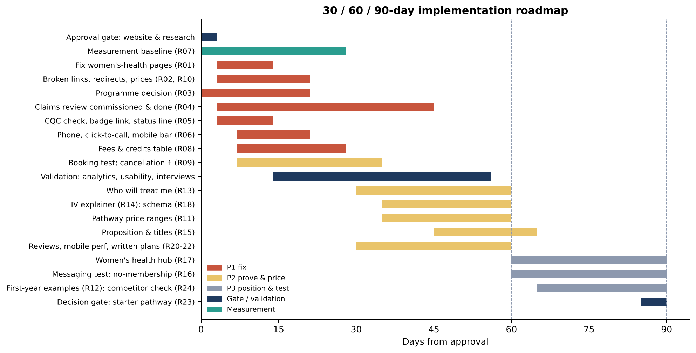

# The HVN: 30 / 60 / 90-Day Implementation Roadmap

**Version:** 1.0, 15 October 2026. Day 0 is your approval (gate G0). The roadmap is built from `recommendations-register.md` (R-IDs) and `validation-plan.md` (H-IDs and gates G1–G5).

> **Nothing is deployed.** Every website, booking-system or customer-contact step below is a proposal awaiting your approval. Owners are suggested **roles**, not named people.

## Guiding logic
1. **Days 0–30, fix and measure:** cheap, verified defects first; start the measurement baseline at once; commission the claims review; verify the CQC status. None of this depends on customer validation.
2. **Days 31–60, prove and price:** add trust proof (who treats, IV explainer) and price clarity (ranges), informed by the first validation results.
3. **Days 61–90, position and test:** adopt the proposition and segment moves only where validation supports them; gate the starter-pathway decision.

## Days 0–30: fix and measure

| Week | Action | R-ID | Owner (suggested) | Deliverable | KPI / done when | Depends on |
|---|---|---|---|---|---|---|
| 0 | Approve roadmap, website-change process and research gates | — | CEO/Founder | G0 / G1 decisions | Approvals recorded | — |
| 1 | Analytics events, enquiry log, Pabau reports | R07 | Marketing lead + agency; Ops lead | Baseline dashboard | Events firing; log in daily use | G1 |
| 1 | Programme decision: which plans exist, and their prices or ranges | R03 | CEO + Medical Director | Decision note | Recorded | — |
| 1 | Brief and commission the CAP-code claims review | R04 | CEO; external adviser | Signed engagement | Adviser engaged | Budget approval |
| 1 | Check CQC status and regulated activities at source | R05 | Registered manager | Screenshot + wording | Accurate status known | — |
| 1–2 | Fix the Menopause, PCOS and PMDD pages | R01 | Marketing lead; women's-health doctor; developer | 3 corrected pages | 0 off-topic blocks | G4 (deploy) |
| 1–3 | Fix menu 404s, 19 broken links, redirects; 301 retired programme URLs | R02, R03 | Web developer | Clean re-crawl | 0 internal 404s | G4 |
| 1–3 | Reconcile conflicting prices; add course session counts | R10 | Marketing + Ops | Single price source | 0 conflicts in re-crawl | G4 |
| 2 | Link the CQC badge; add an accurate status line | R05 | Developer; compliance sign-off | Live line + link | 100% of pages | R05 check, G4 |
| 2–3 | One phone number, tel: links, sticky mobile Call/Book bar | R06 | Developer; Ops | Live bar | tel: on 100% of pages; click-to-call events | G4 |
| 2–4 | Consultation fees and credits table | R08 | CEO + Finance (policy); Marketing | Live table | Published | Policy decision, G4 |
| 2–5 | Internal booking-flow test; then show the cancellation charge in £ | R09 | Ops / Pabau admin | Test report; settings change | Charge shown at booking | G1, G4 |
| 2–4 | Start usability tests (non-clients) and interview recruitment | H01–H13 | Marketing lead | Sessions booked | 5–6 sessions done | G2, G3 |
| 1–4 | Log first-response times | R19 | Ops / concierge lead | 4-week log | Median response time known | R07 |

**30-day checkpoint:**
- Baseline captured.
- Women's-health pages fixed.
- 0 internal 404s.
- CQC line accurate.
- Claims review under way.
- Usability findings available.

## Days 31–60: prove and price

| Week | Action | R-ID | Owner | KPI | Depends on |
|---|---|---|---|---|---|
| 5–8 | "Who will treat me" blocks on all service pages | R13 | Medical Director + Marketing; developer | 100% coverage; service-page booking clicks vs baseline | Usability (H04), G4 |
| 5–7 | Implement claims-review changes (IV/IM, injectables, superlatives) | R04 | Marketing; Medical Director | 100% of flagged items resolved | Review report |
| 6–8 | "What happens before your IV" explainer | R14 | Medical Director | Live on IV/IM pages | R04 |
| 5–8 | Indicative pathway price ranges from 12 months of Pabau data | R11 | CEO + Finance + Medical Director | Consultation-to-plan conversion; price-question enquiries | Interviews (H01, H02), G4 |
| 5–7 | Clinic structured data; title fixes | R18 | Developer / SEO | Rich Results valid | G4 |
| 5–8 | Written consultation summary and plan template | R20 | Medical Director + Ops | % of consultations with a plan in 48 h | Current-practice check |
| 5–8 | Review rating check; show in HTML; post-visit review request | R21 | Marketing | Rating; reviews per month | G4 |
| 5–8 | Mobile performance test and fixes | R22 | Developer | Core Web Vitals pass | — |
| 6–9 | Proposition line and consistent titles (after interviews) | R15 | Marketing + CEO | Consistent titles; comprehension in interviews | H06, H07, H13; R04 |
| 6 | **Validation read-out** | — | Marketing lead | Hypothesis report | Workstreams A–D |

**60-day checkpoint:**
- Trust proof live.
- Ranges published, or deliberately rejected on the evidence.
- Claims changes done.
- Validation read-out complete.
- First pre/post comparisons available.

## Days 61–90: position and test

| Week | Action | R-ID | Owner | KPI | Depends on |
|---|---|---|---|---|---|
| 9–13 | Women's-health and fertility hub (if H08 is supported) | R17 | Women's-health doctor + Marketing | Hub sessions; consultations from the hub | H08, G4 |
| 9–13 | Test "no membership" messaging (if H06 is supported) | R16 | Marketing | A/B click-through to booking | H06, R04, G4 |
| 10–13 | "Your first year" worked examples | R12 | Marketing + Finance | Engagement; use in consultations | R11 |
| 10–13 | First quarterly competitor and regulator check at source | R24 | Marketing analyst | ≥ 80% of benchmark facts verified at source | Browser access; G5 for any contact |
| 13 | **Decision gate: priced starter pathway** | R23 | CEO + Medical Director + Finance | Go / no-go with business case | H01, H02, H11; R11 data |

**90-day checkpoint (management review):**
- KPI movement vs baseline: booking intent, booking completion, consultation-to-plan conversion, price-question enquiries, 404s, click-to-call.
- Validation results.
- Decisions on the proposition, the hub and the pathway.

## Resourcing summary (indicative)

| Role | Days 0–30 | 31–60 | 61–90 |
|---|---|---|---|
| Web developer / agency | 6–9 days | 10–14 days | 6–10 days |
| Marketing lead | 6–8 days | 8–10 days | 6–8 days |
| Medical Director / women's-health doctor | 2–3 days | 4–6 days | 2–4 days |
| Operations / concierge lead | 3–4 days | 2–3 days | 1–2 days |
| CEO / Finance | 2 days (decisions) | 2–3 days (ranges) | 1–2 days (gate) |
| External | Claims adviser (quote needed); research ≈ £1,000–£1,800 | — | — |

## Risks and mitigations

| Risk | Mitigation |
|---|---|
| The CQC status turns out to differ from v1 | R05 checks it **before** any wording is published |
| Price ranges anchor clients too high or too low | Base them on actual 12-month Pabau data; test wording in usability sessions first |
| The claims review takes longer than 30 days | Pause new IV/longevity copy and any paid media until it is done |
| Simulation-derived messaging doesn't match real clients | Validation gates (H06, H07, H13) come before any proposition change |
| Website changes break booking links | Developer QA checklist; re-crawl after every release |
