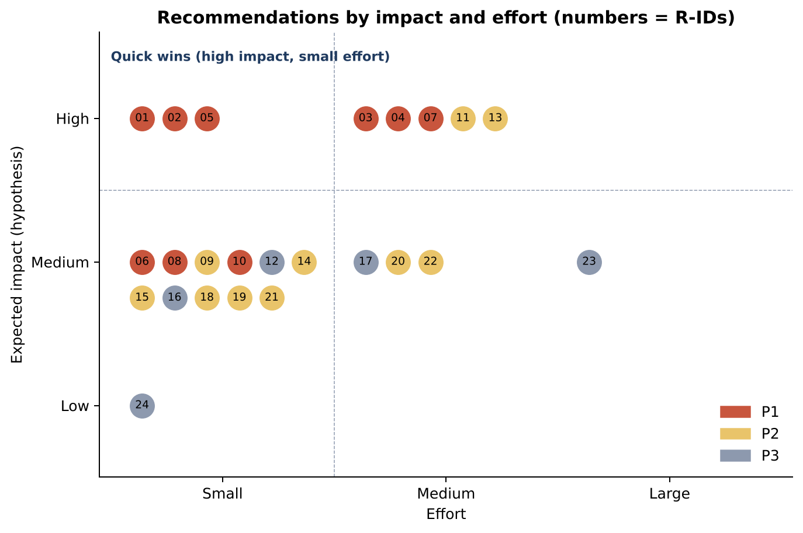

# The HVN: Recommendations Register

**Version:** 1.0, 15 October 2026 · **Generated by** `charts/build_assets.py` (also `recommendations-register.csv`).

Each recommendation states the problem, its supporting evidence and confidence, the proposed solution, a business-impact **hypothesis**, effort, a suggested owner (a role, not a named person), priority and a measurable KPI.

- **Confidence** applies to the *problem evidence*, not to the predicted impact: **High** = verified on the-hvn.com (crawl 15 Oct 2026, re-checked where stated); **Medium** = verified gap but uncertain effect, or a regulator/official source found by search; **Low** = simulated or directory signal only.
- **Impact** is a hypothesis until measured (see `validation-plan.md`). **Effort:** Small ≤ 3 days, Medium 3–10 days, Large > 10 days or an external dependency.
- **Priority:** P1 = first 30 days; P2 = days 31–60; P3 = days 61–90 or gated on validation.
- **Nothing here has been deployed.** Every website, booking-system or customer-contact action needs your approval first.

## Summary

| ID | Area | Recommendation | Evidence confidence | Impact | Effort | Owner (suggested) | Priority | Window | KPI |
|---|---|---|---|---|---|---|---|---|---|
| R01 | Website | Fix the Menopause, PCOS and PMDD pages | High | High | Small | Marketing lead (content) | **P1** | 0-30 | 3/3 pages corrected; booking-link clicks and enquiries from the 3 pages vs 4-week baseline (GA4); consultations attributed in Pabau |
| R02 | Website | Repair broken navigation and internal links | High | High | Small | Web developer / agency | **P1** | 0-30 | 0 internal 404s in a re-crawl; GA4 404 page views near zero |
| R03 | Pricing | Decide the programme tier; redirect retired URLs; remove the orphan page | High | High | Medium | CEO/Founder + Medical Director (decision) | **P1** | 0-30 | Decision recorded; 0 retired programme URLs returning 404; programme page views and enquiries |
| R04 | Compliance | Commission a CAP-code claims review before any campaign | High | High | Medium | CEO/Founder + external adviser | **P1** | 0-30 | Review completed; 100% of flagged items resolved or accepted with rationale; 0 upheld ASA complaints |
| R05 | Trust | Verify CQC status and scope, then link the badge and add a plain status line | Medium | High | Small | Registered manager / compliance lead | **P1** | 0-30 | Badge linked on 100% of pages; wording signed off by compliance; status re-checked quarterly |
| R06 | Conversion | One phone number, click-to-call and a sticky mobile Call/Book bar | High | Medium | Small | Web developer | **P1** | 0-30 | tel: on 100% of pages; click-to-call events per week; answered-call rate |
| R07 | Measurement | Set up the analytics and booking-funnel baseline | High | High | Medium | Marketing lead + analytics agency | **P1** | 0-30 | Dashboard live; baseline recorded for the 8 funnel metrics in the journey map |
| R08 | Pricing | Publish one consultation fees and credits table | High | Medium | Small | CEO/Founder + Finance (policy) | **P1** | 0-30 | Table live; share of enquiries tagged 'credit/fee question'; consultation booking rate |
| R09 | Pricing | Show the cancellation charge in pounds at booking | Medium | Medium | Small | Operations lead / Pabau administrator | **P2** | 0-30 | Booking-flow completion rate (Pabau); cancellation disputes per month |
| R10 | Pricing | Remove price conflicts and show sessions per course | High | Medium | Small | Marketing lead + Operations lead | **P1** | 0-30 | 0 conflicting prices in a re-crawl of the price register |
| R11 | Pricing | Publish indicative pathway price ranges | Medium | High | Medium | CEO/Founder + Finance + Medical Director | **P2** | 31-60 | Consultation-to-plan acceptance; booking rate on pathway pages; price-question enquiries |
| R12 | Pricing | Add 'your first year' worked examples | Low | Medium | Small | Marketing lead + Finance | **P3** | 61-90 | Page engagement; use in consultations (staff survey) |
| R13 | Trust | Add 'Who will treat me' to every service page | High | High | Medium | Medical Director + Marketing lead | **P2** | 31-60 | Coverage on 100% of service pages; service-page-to-booking click rate vs baseline |
| R14 | Trust | Publish 'What happens before your IV' | Medium | Medium | Small | Medical Director | **P2** | 31-60 | Page live on all IV/IM pages; IV page booking clicks vs baseline |
| R15 | Positioning | One proposition line and consistent titles; retire unsupported superlatives | High | Medium | Small | Marketing lead + CEO/Founder | **P2** | 31-60 | Consistent titles on 100% of pages; Search Console CTR on brand and category queries; comprehension in interviews |
| R16 | Positioning | Test 'no membership, pay as you go' as a differentiator | Low | Medium | Small | Marketing lead | **P3** | 61-90 | Interview preference; A/B click-through to booking |
| R17 | Segment | Build a women's health and fertility hub | Medium | Medium | Medium | Women's-health doctor + Marketing lead | **P3** | 61-90 | Hub sessions; consultations booked from the hub |
| R18 | SEO | Add clinic structured data and fix metadata | High | Medium | Small | Web developer / SEO | **P2** | 31-60 | Rich Results test valid; local impressions (Search Console / Business Profile) |
| R19 | Conversion | Measure and set a speed-to-lead standard | Low | Medium | Small | Operations / concierge lead | **P2** | 0-30 | Median first-response time; enquiry-to-booking rate |
| R20 | Experience | Give every consultation a written summary and plan | Low | Medium | Medium | Medical Director + Operations lead | **P2** | 31-60 | % consultations with a written plan within 48 h; plan acceptance rate |
| R21 | Trust | Check and surface the review rating | Low | Medium | Small | Marketing lead | **P2** | 31-60 | Rating; new reviews per month |
| R22 | Website | Test and fix mobile performance | Medium | Medium | Medium | Web developer | **P2** | 31-60 | Core Web Vitals pass; mobile bounce/engagement vs baseline |
| R23 | Offer | Pilot a priced first-step pathway (gated on validation) | Low | Medium | Large | CEO/Founder + Medical Director + Finance | **P3** | after 90 (gated) | Uptake; conversion to a full plan; margin |
| R24 | Monitoring | Quarterly competitor and regulatory check at primary sources | High | Low | Small | Marketing analyst | **P3** | 61-90 | Benchmark refreshed quarterly with >=80% of facts verified at source |

## Detail

### R01 · Fix the Menopause, PCOS and PMDD pages  (P1, 0-30 days)

| | |
|---|---|
| **Problem** | All three women's-health pages list acne lasers and peels as 'our available treatments'. |
| **Supporting evidence** | Re-checked live 15 Oct 2026: /menopause/ shows 'Explore our specialised solutions for rosacea, acne, and acne scarring' (Fotona Active Acne £475 etc.). Audit W1; crawl CSV. |
| **Evidence confidence** | High |
| **Proposed solution** | Replace the block with the real pathway: women's-health doctor consultation, hormonal/menopause acupuncture (from £200; course from £1,620 with session count), relevant blood profiles, fertility panel (£500) where relevant. Retitle pages ('Menopause Support in Knightsbridge | The HVN'). Clinical sign-off before publishing. |
| **Business-impact hypothesis** | Visitors with menopause/PCOS/PMDD intent see a relevant next step, so more of them enquire or book; removes a visible credibility defect. (expected impact: High) |
| **Effort** | Small: 1-3 days content + clinical review |
| **Owner (suggested role)** | Marketing lead (content); women's-health doctor (clinical sign-off); web developer |
| **KPI** | 3/3 pages corrected; booking-link clicks and enquiries from the 3 pages vs 4-week baseline (GA4); consultations attributed in Pabau |
| **Approval gate** | Website change: needs your approval |

### R02 · Repair broken navigation and internal links  (P1, 0-30 days)

| | |
|---|---|
| **Problem** | Two menu links on every page return 404; 19 broken internal links; 22 links via redirects; a sitemap URL redirects into a 404. |
| **Supporting evidence** | Re-checked 15 Oct 2026: /clinical-treatments/ and /holistic-rituals/ return 404 (linked from 212/212 pages). evidence/hvn-broken-links-2026-10-15.csv; audit W2, W6. |
| **Evidence confidence** | High |
| **Proposed solution** | Point the menu at live hub pages (or create them); 301 every broken or retired path; update in-body links to final URLs; fix /fotona-3d-peel/ chain; add 404 monitoring. |
| **Business-impact hypothesis** | Fewer dead ends in navigation, better crawl efficiency and fewer lost sessions. (expected impact: High) |
| **Effort** | Small: 2-3 developer days |
| **Owner (suggested role)** | Web developer / agency |
| **KPI** | 0 internal 404s in a re-crawl; GA4 404 page views near zero |
| **Approval gate** | Website change: needs your approval |

### R03 · Decide the programme tier; redirect retired URLs; remove the orphan page  (P1, 0-30 days)

| | |
|---|---|
| **Problem** | The consultation-to-plan step has no visible destination: programme pages 404 and /functional-medicine/ lands on an unfinished 'Updated' page. |
| **Supporting evidence** | Re-checked 15 Oct 2026: /hvn-360-proactive-health-programme/ 404. 7 retired URLs 404; orphan page has no H1, meta description or prices; Discovery's £100 credit points to unpriced 'packages'. Audit W3. |
| **Evidence confidence** | High |
| **Proposed solution** | Management decides which programmes exist today. Publish them (price or range), or 301 each retired URL to the nearest live page; finish or remove the orphan page. |
| **Business-impact hypothesis** | Restores a destination for the highest-value journey; removes 404s that press and search still point to. (expected impact: High) |
| **Effort** | Medium: Management decision + 3-5 developer/content days |
| **Owner (suggested role)** | CEO/Founder + Medical Director (decision); web developer |
| **KPI** | Decision recorded; 0 retired programme URLs returning 404; programme page views and enquiries |
| **Approval gate** | Business decision + website change |

### R04 · Commission a CAP-code claims review before any campaign  (P1, 0-30 days)

| | |
|---|---|
| **Problem** | Health-claim wording risk on IV/IM, injectables and superlatives. |
| **Supporting evidence** | Immune/boost wording on 19/20 IV/IM pages; 'Fat Burner IV'; botulinum toxin named next to prices; 'London's leading' in the home page and the site-wide schema description. ASA IVNT guidance and 2023 rulings (Get A Drip, REVIV). |
| **Evidence confidence** | High |
| **Proposed solution** | Brief a qualified advertising/regulatory adviser on IV/IM, injectables and superlative wording; implement the changes before paid media or new messaging. |
| **Business-impact hypothesis** | Reduces regulatory and reputational exposure; a precondition for any paid campaign or new positioning. (expected impact: High) |
| **Effort** | Medium: External review 2-4 weeks; cost to be quoted |
| **Owner (suggested role)** | CEO/Founder + external adviser; Medical Director |
| **KPI** | Review completed; 100% of flagged items resolved or accepted with rationale; 0 upheld ASA complaints |
| **Approval gate** | Spend: needs management approval |

### R05 · Verify CQC status and scope, then link the badge and add a plain status line  (P1, 0-30 days)

| | |
|---|---|
| **Problem** | A 'CQC Regulated' image appears on every page but links nowhere; the inspection status used in v1 is not verified. |
| **Supporting evidence** | Badge on 212/212 pages, register link on 0 [crawl; re-checked]. Status 'registered, not yet inspected' comes from a v1 search result only; a 15 Oct 2026 search did not surface the record. CQC does not regulate some non-surgical cosmetic procedures (shown in a peer clinic's CQC report via search). |
| **Evidence confidence** | Medium |
| **Proposed solution** | Registered manager checks the provider and location pages on cqc.org.uk, including regulated activities and rating status; link the badge to the location page; add one accurate line (e.g. 'Registered with the CQC for [activities]; [rating / not yet rated]'). Do not imply that CQC covers every service. |
| **Business-impact hypothesis** | Turns a decorative badge into verifiable proof; avoids implying wider coverage than the registration gives. (expected impact: High) |
| **Effort** | Small: 1 day after the check |
| **Owner (suggested role)** | Registered manager / compliance lead; web developer |
| **KPI** | Badge linked on 100% of pages; wording signed off by compliance; status re-checked quarterly |
| **Approval gate** | Website change: needs your approval |

### R06 · One phone number, click-to-call and a sticky mobile Call/Book bar  (P1, 0-30 days)

| | |
|---|---|
| **Problem** | Phone-first and concierge buyers cannot tap to call from service pages; two numbers are in use. |
| **Supporting evidence** | tel: link on 1/212 pages (audit W10; 15 Oct spot-check of 16 pages: home only). 020 8015 7987 and 020 7160 0003 both published. WhatsApp mentioned on 18 pages. |
| **Evidence confidence** | High |
| **Proposed solution** | Choose one number; add tel: links site-wide; add a sticky mobile bar (Call / Book / WhatsApp); add call tracking. |
| **Business-impact hypothesis** | Easier contact for time-poor and gatekeeper buyers; more calls from mobile service pages. (expected impact: Medium) |
| **Effort** | Small: 1-2 developer days |
| **Owner (suggested role)** | Web developer; Operations/concierge lead |
| **KPI** | tel: on 100% of pages; click-to-call events per week; answered-call rate |
| **Approval gate** | Website change: needs your approval |

### R07 · Set up the analytics and booking-funnel baseline  (P1, 0-30 days)

| | |
|---|---|
| **Problem** | No analytics, booking or enquiry data was available, so no recommendation can yet be measured. |
| **Supporting evidence** | Study had no GA4, Search Console, Pabau or CRM access (dossier §0.2). v1 KPIs had no baselines. |
| **Evidence confidence** | High |
| **Proposed solution** | Define GA4 events (book click, tel click, form, WhatsApp), UTMs, a Pabau report for consultation-to-plan conversion, and an enquiry log with reason tags (price, practitioner, CQC, availability). Capture a 4-week baseline before changes where possible. |
| **Business-impact hypothesis** | Makes every other recommendation measurable; shows which pages and segments actually produce bookings. (expected impact: High) |
| **Effort** | Medium: 3-5 days agency/internal |
| **Owner (suggested role)** | Marketing lead + analytics agency; Operations lead (Pabau) |
| **KPI** | Dashboard live; baseline recorded for the 8 funnel metrics in the journey map |
| **Approval gate** | Internal; no customer contact |

### R08 · Publish one consultation fees and credits table  (P1, 0-30 days)

| | |
|---|---|
| **Problem** | Only the £350 Discovery Consultation states a credit (£100); the £175 and £400 consultations state none. |
| **Supporting evidence** | Re-checked 15 Oct 2026: credit wording on /discovery-consultation/ only, not on /aesthetic-consultation/. Raised repeatedly in S1 run 2, S2a and S2b [simulated]. |
| **Evidence confidence** | High |
| **Proposed solution** | Management sets the credit policy; publish one table (fee, length, clinician, what you receive, credit rules) on the consultations page and each consultation page. |
| **Business-impact hypothesis** | Reduces 'pay to be quoted' hesitation and confusion between consultation types. (expected impact: Medium) |
| **Effort** | Small: Policy decision + 1 content day |
| **Owner (suggested role)** | CEO/Founder + Finance (policy); Marketing lead |
| **KPI** | Table live; share of enquiries tagged 'credit/fee question'; consultation booking rate |
| **Approval gate** | Business decision + website change |

### R09 · Show the cancellation charge in pounds at booking  (P2, 0-30 days)

| | |
|---|---|
| **Problem** | Terms require a card and 24 hours' notice; what is charged, and where it is shown, is unknown. |
| **Supporting evidence** | Terms of service [verified]; booking screens untested (Pabau domain blocked) [NEEDS TESTING]. S2a A3, S2b B4 [simulated]. |
| **Evidence confidence** | Medium |
| **Proposed solution** | Run an internal booking test (stop before payment); then state the charge in £ next to the booking button and in confirmations. |
| **Business-impact hypothesis** | Fewer abandoned bookings and fewer disputes. (expected impact: Medium) |
| **Effort** | Small: Half-day test + Pabau settings |
| **Owner (suggested role)** | Operations lead / Pabau administrator |
| **KPI** | Booking-flow completion rate (Pabau); cancellation disputes per month |
| **Approval gate** | Booking-system change: needs your approval |

### R10 · Remove price conflicts and show sessions per course  (P1, 0-30 days)

| | |
|---|---|
| **Problem** | The same service shows different prices on different pages; course session counts are missing. |
| **Supporting evidence** | NAD £375/60 min (fatigue page) vs £350/90 min (NAD page); fertility acupuncture from £200 vs from £270/£300; course 'from £1,620' without session count. Price register CSV. |
| **Evidence confidence** | High |
| **Proposed solution** | Single price source; reconcile duplicates; state sessions and validity per course. |
| **Business-impact hypothesis** | Removes doubt at the decision point; protects trust in published prices (a verified strength). (expected impact: Medium) |
| **Effort** | Small: 1-2 days |
| **Owner (suggested role)** | Marketing lead + Operations lead |
| **KPI** | 0 conflicting prices in a re-crawl of the price register |
| **Approval gate** | Website change: needs your approval |

### R11 · Publish indicative pathway price ranges  (P2, 31-60 days)

| | |
|---|---|
| **Problem** | After a £175-£750 entry step, no programme price is visible except 8R 'from £3,000'. |
| **Supporting evidence** | Programmes unpriced; old programme pages 404 [verified]. A £15,500 12-week programme anchor exists in the market (Pillar, reported). Simulated agents asked for a written range (S1 run 2, S2a, S2b), partly prompted by the seed. |
| **Evidence confidence** | Medium |
| **Proposed solution** | Compute typical 3-month spend ranges from 12 months of Pabau data for 3-4 pathways (fatigue, longevity, skin, women's health); publish with assumptions ('most clients spend £X-£Y'). Validate wording in usability tests first. |
| **Business-impact hypothesis** | Lower uncertainty raises consultation bookings and plan acceptance (to be validated). (expected impact: High) |
| **Effort** | Medium: Data pull + decision + 3 content days |
| **Owner (suggested role)** | CEO/Founder + Finance + Medical Director |
| **KPI** | Consultation-to-plan acceptance; booking rate on pathway pages; price-question enquiries |
| **Approval gate** | Business decision + website change |

### R12 · Add 'your first year' worked examples  (P3, 61-90 days)

| | |
|---|---|
| **Problem** | Buyers cannot see a realistic 12-month cost. |
| **Supporting evidence** | S2b B2 [simulated, directional]; depends on R11 data. |
| **Evidence confidence** | Low |
| **Proposed solution** | After R11, publish 2-3 dated, assumption-labelled examples. |
| **Business-impact hypothesis** | Helps planners and gatekeepers budget; may reduce sticker shock. (expected impact: Medium) |
| **Effort** | Small: 2 days after R11 |
| **Owner (suggested role)** | Marketing lead + Finance |
| **KPI** | Page engagement; use in consultations (staff survey) |
| **Approval gate** | Website change: needs your approval |

### R13 · Add 'Who will treat me' to every service page  (P2, 31-60 days)

| | |
|---|---|
| **Problem** | Every page shows the same four practitioner names, including the acupuncturist on IV and injectables pages. |
| **Supporting evidence** | Crawl check [verified]. 'Who will treat me' raised in all five full runs [simulated]. |
| **Evidence confidence** | High |
| **Proposed solution** | Treatment-specific clinician block: role, qualifications, professional registration body and number where applicable. |
| **Business-impact hypothesis** | Raises trust for new clients, especially aesthetics and gatekeeper buyers. (expected impact: High) |
| **Effort** | Medium: 5-8 days content across ~150 pages (template-driven) |
| **Owner (suggested role)** | Medical Director + Marketing lead; web developer |
| **KPI** | Coverage on 100% of service pages; service-page-to-booking click rate vs baseline |
| **Approval gate** | Website change: needs your approval |

### R14 · Publish 'What happens before your IV'  (P2, 31-60 days)

| | |
|---|---|
| **Problem** | The best trust line on the site (a doctor check before every IV) is not explained. |
| **Supporting evidence** | IV page: 'a brief 10 minute consultation with one of our doctors' [re-checked 15 Oct 2026]. S3 M3-M4 [simulated]. |
| **Evidence confidence** | Medium |
| **Proposed solution** | Explain the steps, contraindications, who prescribes and supervises, ingredients and doses, and what the evidence does and does not show. After R04. |
| **Business-impact hypothesis** | Turns an existing safeguard into visible proof. (expected impact: Medium) |
| **Effort** | Small: 2 days + clinical sign-off |
| **Owner (suggested role)** | Medical Director |
| **KPI** | Page live on all IV/IM pages; IV page booking clicks vs baseline |
| **Approval gate** | Website change: needs your approval |

### R15 · One proposition line and consistent titles; retire unsupported superlatives  (P2, 31-60 days)

| | |
|---|---|
| **Problem** | The category is unclear and the copy contradicts itself. |
| **Supporting evidence** | Home H1 'HOW THE HVN CAN HELP'; Contact and Booking titles say 'Skin & Hair'; 'London's leading' on the home page and in the site schema description [verified]. |
| **Evidence confidence** | High |
| **Proposed solution** | Adopt a candidate line after interviews (working draft: 'Doctor-led care for skin, energy and long-term health: one Knightsbridge team, clear prices, no membership'); update H1, titles and schema description. |
| **Business-impact hypothesis** | Clearer category; lower claim risk; better search snippets. (expected impact: Medium) |
| **Effort** | Small: 2 days after the decision |
| **Owner (suggested role)** | Marketing lead + CEO/Founder |
| **KPI** | Consistent titles on 100% of pages; Search Console CTR on brand and category queries; comprehension in interviews |
| **Approval gate** | Business decision + website change |

### R16 · Test 'no membership, pay as you go' as a differentiator  (P3, 61-90 days)

| | |
|---|---|
| **Problem** | Rivals reportedly sell memberships; The HVN does not offer one. Whether buyers value that is unknown. |
| **Supporting evidence** | No membership on site [verified; confirmed by you]. Rival memberships reported, unverified. S4: 10/11 agents saw it as an advantage, but the seed emphasised it [simulated, primed]. |
| **Evidence confidence** | Low |
| **Proposed solution** | Test in interviews and usability sessions before using it in headlines; then a hero-copy test. |
| **Business-impact hypothesis** | Could differentiate against clubs for selective users; could equally read as 'less exclusive'. (expected impact: Medium) |
| **Effort** | Small: Included in validation work |
| **Owner (suggested role)** | Marketing lead |
| **KPI** | Interview preference; A/B click-through to booking |
| **Approval gate** | Customer research: needs your approval |

### R17 · Build a women's health and fertility hub  (P3, 61-90 days)

| | |
|---|---|
| **Problem** | Women's-health demand has no coherent route; specialists are reported to be cheaper for single needs. |
| **Supporting evidence** | Women's-health doctor and TCM content [verified]; W1 defect [verified]; specialist prices £185-£275 and ~£90 [directory, unverified]; S4 [simulated]. |
| **Evidence confidence** | Medium |
| **Proposed solution** | One hub linking doctor, acupuncture, tests and course totals; describe coordination with the client's GP or specialist. |
| **Business-impact hypothesis** | Captures single-need demand that currently goes to specialists. (expected impact: Medium) |
| **Effort** | Medium: 8-12 days |
| **Owner (suggested role)** | Women's-health doctor + Marketing lead |
| **KPI** | Hub sessions; consultations booked from the hub |
| **Approval gate** | Website change: needs your approval |

### R18 · Add clinic structured data and fix metadata  (P2, 31-60 days)

| | |
|---|---|
| **Problem** | No MedicalClinic/LocalBusiness schema; title errors. |
| **Supporting evidence** | Schema is Organization/WebSite/WebPage/Breadcrumb only; 6 titles >60 characters; Fotona '4D' vs '5D' mismatch. Audit W9, W11. |
| **Evidence confidence** | High |
| **Proposed solution** | MedicalClinic with address, geo, hours, phone; Service/Offer on service pages; Physician for clinicians; fix titles. |
| **Business-impact hypothesis** | Better local and organic visibility. (expected impact: Medium) |
| **Effort** | Small: 2-4 developer days |
| **Owner (suggested role)** | Web developer / SEO |
| **KPI** | Rich Results test valid; local impressions (Search Console / Business Profile) |
| **Approval gate** | Website change: needs your approval |

### R19 · Measure and set a speed-to-lead standard  (P2, 0-30 days)

| | |
|---|---|
| **Problem** | Response time to enquiries is unknown. |
| **Supporting evidence** | Concierge contact model [verified]; S2a A7 'same-day doctor call-back' [simulated, single run]. |
| **Evidence confidence** | Low |
| **Proposed solution** | Log first-response times for 4 weeks; set a standard only if slow responses correlate with lost bookings. |
| **Business-impact hypothesis** | Faster responses convert more time-poor enquiries. (expected impact: Medium) |
| **Effort** | Small: Process change |
| **Owner (suggested role)** | Operations / concierge lead |
| **KPI** | Median first-response time; enquiry-to-booking rate |
| **Approval gate** | Internal |

### R20 · Give every consultation a written summary and plan  (P2, 31-60 days)

| | |
|---|---|
| **Problem** | Whether clients leave with a written plan and total is unknown. |
| **Supporting evidence** | S1 run 2 #10, S2b B9 [simulated]; current practice unknown. |
| **Evidence confidence** | Low |
| **Proposed solution** | Confirm current practice; if missing, adopt a template: findings, plan, total, alternatives, what is not recommended. |
| **Business-impact hypothesis** | Higher plan acceptance and trust; counters 'upsell' perceptions (one 2025 blog anecdote). (expected impact: Medium) |
| **Effort** | Medium: Template + training |
| **Owner (suggested role)** | Medical Director + Operations lead |
| **KPI** | % consultations with a written plan within 48 h; plan acceptance rate |
| **Approval gate** | Internal |

### R21 · Check and surface the review rating  (P2, 31-60 days)

| | |
|---|---|
| **Problem** | A reviews widget is on 157/212 pages, but the rating is not in the HTML and is unknown to this study. |
| **Supporting evidence** | Crawl [verified]; Google rating and volume unknown; one negative 2025 blog anecdote [press]. |
| **Evidence confidence** | Low |
| **Proposed solution** | Check Business Profile rating and volume; if strong, show it in HTML (compliant schema); add a post-visit review request. |
| **Business-impact hypothesis** | Social proof for first-time buyers. (expected impact: Medium) |
| **Effort** | Small: 1-2 days |
| **Owner (suggested role)** | Marketing lead |
| **KPI** | Rating; new reviews per month |
| **Approval gate** | Website change: needs your approval |

### R22 · Test and fix mobile performance  (P2, 31-60 days)

| | |
|---|---|
| **Problem** | Pages are heavy and mobile rendering is untested. |
| **Supporting evidence** | Median 713 KB HTML and 55 images per page [verified]; headless browser blocked (403), so mobile untested. |
| **Evidence confidence** | Medium |
| **Proposed solution** | Lighthouse / Core Web Vitals from a normal connection; trim repeated blocks and images. |
| **Business-impact hypothesis** | Faster mobile pages reduce drop-off. (expected impact: Medium) |
| **Effort** | Medium: 3-6 developer days |
| **Owner (suggested role)** | Web developer |
| **KPI** | Core Web Vitals pass; mobile bounce/engagement vs baseline |
| **Approval gate** | Website change: needs your approval |

### R23 · Pilot a priced first-step pathway (gated on validation)  (P3, after 90 (gated) days)

| | |
|---|---|
| **Problem** | No priced bridge from consultation to plan. |
| **Supporting evidence** | S2b hypothetical £850 pathway: directional only, discussed in one sub-thread [simulated]. |
| **Evidence confidence** | Low |
| **Proposed solution** | Design only if interviews and R11 data support it: credit the full fee and show follow-on costs on the same page. |
| **Business-impact hypothesis** | Could convert hesitant buyers; could also cannibalise higher-value plans. (expected impact: Medium) |
| **Effort** | Large: Clinical, pricing and ops design |
| **Owner (suggested role)** | CEO/Founder + Medical Director + Finance |
| **KPI** | Uptake; conversion to a full plan; margin |
| **Approval gate** | Business decision |

### R24 · Quarterly competitor and regulatory check at primary sources  (P3, 61-90 days)

| | |
|---|---|
| **Problem** | No competitor price, membership or rating could be verified at source. |
| **Supporting evidence** | Competitor sites, CQC and ASA blocked from this environment; 15 Oct 2026 searches could not confirm HUM2N or Harrods 2026 prices. |
| **Evidence confidence** | High |
| **Proposed solution** | Quarterly dated check of rivals' own sites and the CQC/ASA registers by someone with normal browser access. |
| **Business-impact hypothesis** | Keeps pricing and positioning decisions grounded in current facts. (expected impact: Low) |
| **Effort** | Small: 1 day per quarter |
| **Owner (suggested role)** | Marketing analyst |
| **KPI** | Benchmark refreshed quarterly with >=80% of facts verified at source |
| **Approval gate** | Internal |
