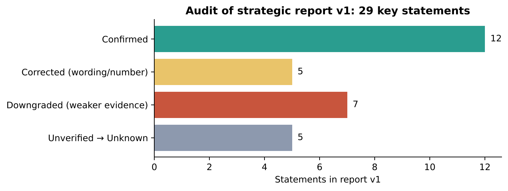

# Audit of the Strategic Intelligence Report v1.0

**Audit date:** 15 October 2026 · **Audited file:** `strategic-intelligence-report.md` v1.0 (superseded by v2.0, which applies every correction below)
**Also checked:** `executive-presentation-outline.md`, the six scenario analyses, `website-audit.md`, `competitors.md`, `dossier.md`, `personas.md`, `evidence/*`.
**No new simulations and no paid Anthropic API calls were made.**

## 1. Method

| Check | How | Limits |
|---|---|---|
| Website facts | Recomputed counts from `evidence/hvn-live-crawl-2026-10-15.csv`, `hvn-price-register-2026-10-15.csv` and `hvn-broken-links-2026-10-15.csv`. **Re-fetched 16 key pages live** on 15 Oct 2026 (polite, sequential): home, contact, both broken menu targets, a retired programme URL, `/functional-medicine/`, the three women's-health pages, three consultation and price pages, the fertility acupuncture page and the IV menu. | Mobile rendering and the Pabau booking flow still could not be tested (headless browser blocked; Pabau domain blocked). |
| Simulation claims | Recounted themes across **all agent comments** in each run's `raw/simulation-db-export.json`, and re-read all 57 interview answers in `raw/interviews.json`. Checked whether each finding was **prompted by the seed or an opening post**. | Keyword counts are approximate; they are used to test the report's claims, not as findings. |
| Competitor and regulatory facts | Tried primary sources directly (competitor sites, cqc.org.uk, asa.org.uk): **all blocked** from this environment. Ran 10 web searches on 15 Oct 2026 to see whether reported figures still appear in 2026 sources. | Search summaries are secondary evidence. Nothing about a competitor could be verified at source. |

**Outcome codes.** **Confirmed** = re-checked and correct. **Corrected** = a number or wording was wrong or overstated; fixed in v2. **Downgraded** = correct as a count, but the evidence is weaker than v1 implied (primed, small sample or persona drift). **Unknown** = could not be verified; v2 now labels it Unknown, showing the reported value only as context.

## 2. Findings

### 2.1 Confirmed (12)

| # | v1 statement (section) | Re-check, 15 Oct 2026 |
|---|---|---|
| C1 | Menopause, PCOS and PMDD pages list acne treatments (§1.5) | **Still live.** `/menopause/` shows "OUR AVAILABLE TREATMENTS · Explore our specialised solutions for rosacea, acne, and acne scarring", then Fotona Active Acne £475, Acne Scarring from £600, ZO peel £185, etc. Same block on `/pcos/` and `/premenstrual-dysphoric-disorder/`. |
| C2 | Two site-wide menu links return 404 (§1.6) | `/clinical-treatments/` → 404; `/holistic-rituals/` → 404; both linked from 212/212 pages (broken-links CSV). |
| C3 | Programme pages return 404; functional medicine dead-ends (§1.2) | `/hvn-360-proactive-health-programme/` → 404. `/functional-medicine/` resolves to the unfinished "Updated" page. |
| C4 | CQC badge on every page but linked on none (§1.3) | Crawl: badge 212/212, register link 0/212. Live: badge is an image with alt "CQC Regulated", no link. |
| C5 | Tap-to-call link on 1 of 212 pages (§5) | Consistent: in the 16-page live sample only the home page has a `tel:` link. |
| C6 | Fee credit stated only for the £350 Discovery Consultation (§4) | `/discovery-consultation/` has the £100 credit wording; `/aesthetic-consultation/` (£175) has none. |
| C7 | NAD price conflict (§4) | Fatigue page shows £375; NAD page shows £350 / £500 / £675 / £800. |
| C8 | Fertility acupuncture start prices conflict (§4) | Register: "From £200" (`/acupuncture-for-fertility-ivf/`) vs "From £270" and "From £300" (`/ivf-and-fertility-susan-gu/`); course "From £1620". |
| C9 | A doctor's 10-minute consultation precedes IV (§2.2) | IV menu: "Your appointment includes a brief 10 minute consultation with one of our doctors…" |
| C10 | Immune/"boost" wording on 19 of 20 IV/IM pages (§5, W4) | From the crawl audit; consistent with the IV menu copy. Not re-counted page by page. |
| C11 | Identical four-name practitioner block on every page (§1.3) | Crawl check in `results/s1-run2-2026-10-15/analysis.md`; not re-checked page by page today. |
| C12 | Run metrics: 207 agent posts and comments, 57 interviews, 490 requests, $0.713 (§8.1) | Matches `results/summary-metrics.json`. |

### 2.2 Corrected (5)

| # | v1 statement | What is actually true | v2 wording |
|---|---|---|---|
| X1 | "London's leading" appears on **212/212 pages** (§1.3, §2.1) | The crawl counted raw HTML. Live re-check: the phrase is **visible on the home page**, and on other pages it sits in the **site-wide structured-data description** ("London's leading wellness & longevity clinic"), which search engines can show but visitors don't see on the page. | "Visible on the home page and present in the site-wide schema description that search engines read." The claim-risk point stands. |
| X2 | Prices on **149 of 151** service pages | The price register lists **148 pages** (342 price points); the crawl's price column agrees (148). The dossier says 148. | "Prices published on about 98% of service pages (148 pages, 342 price points)." |
| X3 | Tests priced **£60–£750** (§1.2) vs dossier **£180–£750** | £60 is the Igloo blood reader; lab blood profiles run £180–£750. | "Lab profiles £180–£750 (plus a £60 finger-prick reader)." |
| X4 | §8.2: IV/NAD evidence questions were raised in **S1 run 2, S3 and S2a** | Recount: **0%** of S2a comments raise it; S1 run 2 14%, S3 23%. | "Raised in S1 run 2 and S3." |
| X5 | "Nobody discussed interiors, the Hydrobed or exclusivity" (§1.3) | The Hydrobed was never mentioned, but atmosphere and ambience appear in **7–8% of comments** in S1 run 2, S2a and S4. In S4 the status persona chose the Lanesborough **for its atmosphere**, and in S2a the holistic persona put "the room feels calm" first. | "Luxury cues were rarely raised and decisive only for the status and holistic personas. The model's cautious voice may under-represent them." |

### 2.3 Downgraded (7)

| # | v1 claim | Why it is weaker | v2 treatment |
|---|---|---|---|
| D1 | S2a: "7 of 11 refused to pay a consultation fee just to find out the total" (§1.2) | The count is right (Helena, Priya, Emma, Sofia, Claire, James, Daniel), but the generated opening post **P1 asked verbatim** "Would you pay a consultation fee just to find out the total?", and the replies repeat the phrase. It is an echo of a leading question, not a spontaneous objection. The underlying fact (programmes unpriced) **is** verified. | Problem: High (verified). Customer reaction: **Low–Medium, primed**. Must be validated with non-leading interview questions. |
| D2 | S4: "no membership" read as an advantage by **10 of 11** (§1.1, §6) | Recount confirms 10/11 interviews. But the answers repeat the seed's fact block almost word for word ("one address, a GP-trained Medical Director, published consultation and blood profile prices, and no membership"), and the seed and interview question both foregrounded membership. | **Low–Medium, primed.** No longer a basis for positioning on its own; it is now hypothesis H06 in `validation-plan.md`. |
| D3 | S4: every agent cited "not yet inspected"; it is "the decisive competitive weakness" (§1.4) | 11/11 interviews mention inspection, but the seed's "Facts to keep straight" block emphasised it. **The status itself is unverified** (see U1). | Moved to **Unknown pending CQC check**. The communication recommendation stays but is gated on verification (R05). |
| D4 | S4: specialists won single-need clients, "6–7 of 11" (§6) | Two of those choices come from **persona drift** (a bride and a journalist choosing fertility or menopause specialists), and one is split. That leaves 5 valid primary choices out of 11 fictional agents. | Directional only. Still consistent with the **verified** women's-health page defect (C1). |
| D5 | §8.2: "Convergence across independent runs raises confidence" | The runs share the same core seed facts, persona set and model, so they are **not independent**. Convergence partly reflects shared inputs. | Shown as a heatmap with a priming note; described as "consistent model reactions to the same facts". |
| D6 | S2b: "12-month total" became the decision metric for **10 of 11** | Keywords appear in 8/11 interviews and 78% of comments, but the S2b seed itself introduced "the programme total stated in advance", and only one sub-thread discussed the pathway. | Directional. |
| D7 | "Women's health is a real opportunity" (§1.5) | The page defect and the clinical capability are verified; **demand, market size and conversion are not**. | Labelled [H]; validated through GA4/Search Console demand and interviews. |

### 2.4 Unverified → now Unknown (5)

| # | v1 statement | Status on 15 Oct 2026 | v2 label |
|---|---|---|---|
| U1 | The HVN is "CQC registered, not yet inspected" (§2.1 [R]; SWOT "[R]/[V]"; recommendation text "first inspection pending") | Source is a v1 search result. cqc.org.uk is blocked here, and a 15 Oct search did not surface the record. **v1 labelled it inconsistently** ([R], [V1 REGULATOR], [V]/[R]). A peer clinic's CQC report (via search) also shows CQC **does not regulate some non-surgical cosmetic procedures**, so the badge may imply wider coverage than the registration gives. | **Unknown.** Verify on cqc.org.uk, including regulated activities, before publishing any status line (R05). |
| U2 | Surrenne: ~£10k/yr + £5k joining, ~100 members | Same figures appear in a 2026 trade guide (Gentleman's Journal) and in Yahoo/Sotheby's guides; none is primary. | **Unknown** (reported value shown as context). |
| U3 | Lanesborough Club & Spa: ~£4–6k | Undated, conflicting magazine figures; no 2026 price found. | **Unknown (sources conflict).** |
| U4 | HUM2N monthly programmes £495–£695 | v1 search-indexed only; a 15 Oct 2026 search found **no** HUM2N programme price. | **Unknown.** |
| U5 | Harrods Wellness Clinic as an operator marketplace with per-treatment prices | Sources date from 2017–2023; operator line-up and prices for 2026 not found. | **Unknown.** |

## 3. Outdated or inconsistent statements in companion files

| File | Statement | Issue | Action taken |
|---|---|---|---|
| `dossier.md` §1 #8 | "The competitive model gap is membership" | v1 report reframed this as an asset; v2 treats it as an **untested hypothesis** (D2) | Noted here; dossier kept as a dated Phase 0 record |
| `dossier.md` §6 | "Earlier status: none. Runs S1–S4 are specified…" | Outdated: all runs are complete | Noted; see `results/summary-metrics.json` |
| `competitors.md` §3 (Surrenne) | "The HVN's lack of a recurring membership product leaves the 'belonging' benefit to Surrenne" | Contradicts the v1 report; both are hypotheses | `competitor-benchmark.md` now holds both framings, labelled as hypotheses |
| `competitors.md` §4 | HUM2N prices labelled [V1-INDEXED] | Not confirmable in 2026 | `competitor-benchmark.md`: **Unknown** |
| `personas.md` P2 | "wants an annual/membership path" | Hypothesis that conflicts with D2; neither is validated | Validation hypothesis H06 |
| `executive-presentation-outline.md` | Slide 3 calls the proposition "doctor-led team, one address, published prices, no membership [V]" and asks to "adopt the positioning direction" | Positioning should be **tested before adoption** | Superseded by `executive-presentation.pptx` |
| `website-audit.md` W4, W7 | "London's leading" on 212/212 pages; CQC "registered, not yet inspected" | See X1 and U1 | Corrected in v2 report and register |

## 4. Gaps in v1 that v2 fills

| Gap in v1 | Where it is addressed |
|---|---|
| No competitor benchmark with verification status per fact | `competitor-benchmark.md` (+ CSV) |
| Journey stopped at booking; nothing on consultation, treatment or retention | `customer-journey-map.md` |
| Recommendations lacked effort, owner, confidence, KPI and approval gates | `recommendations-register.md` (24 items) |
| KPIs had no baselines or measurement source | R07 measurement baseline; KPI tables in the journey map and roadmap |
| Validation was a short list, without method, sample, decision rules or budget | `validation-plan.md` |
| Two v1 decisions ("adopt the positioning", "pilot a priced pathway") were premature | v2: adopt only after validation; pathway gated (R23) |
| No charts | 10 charts in `charts/`, generated by `charts/build_assets.py` |

## 5. Net effect on the conclusions

- **Unchanged, and strongest:** the verified website and pricing problems: women's-health pages, broken navigation, retired programmes, unpriced plan step, unlinked CQC badge, generic practitioner block, price conflicts and claim-wording risk. They are cheap to fix and need no validation.
- **Weakened:** customer-reaction claims taken from simulation (fee to learn the total, no membership as an advantage, inspection as the decisive factor, specialist preference). They remain hypotheses worth testing, and v2 no longer uses them as decision grounds on their own.
- **Now Unknown:** The HVN's CQC inspection status and every competitor price, membership and rating.
