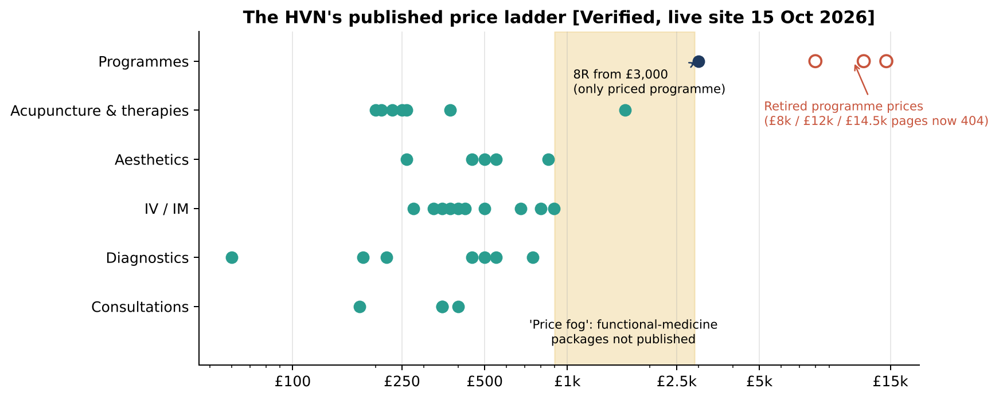
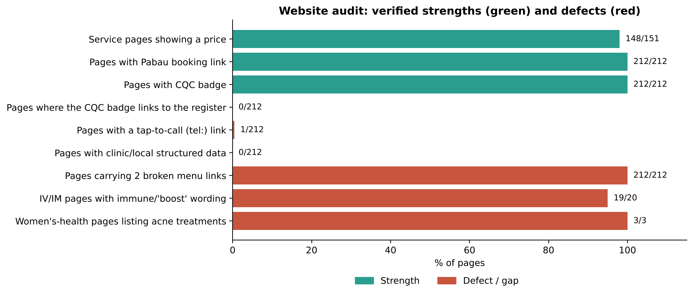
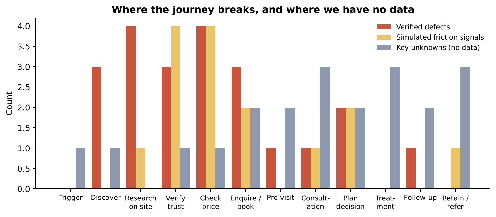
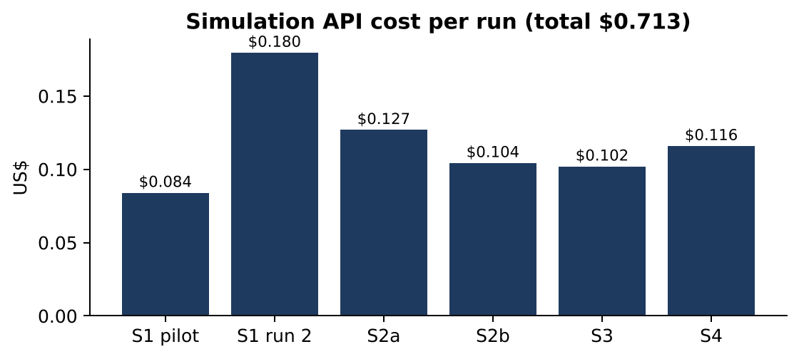
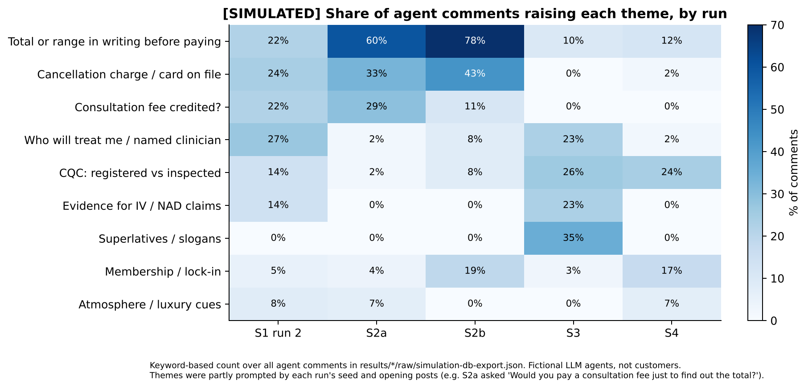

# The HVN: Strategic Intelligence Report

**Subject:** The HVN Wellbeing Ltd, 57–63 Knightsbridge, London SW1X 7BF · **Date:** 15 October 2026 · **Version:** 2.0 (replaces v1.0, audited in `report-audit.md`)
**Purpose:** turn the research and simulations into a management-ready, evidence-backed strategy.

**Companion deliverables:**

| File | Contents |
|---|---|
| `executive-presentation.pptx` | Management deck with speaker notes |
| `recommendations-register.md` / `.csv` | 24 recommendations with evidence, owner, effort, KPI |
| `implementation-roadmap.md` | 30/60/90-day plan |
| `customer-journey-map.md` | Awareness → retention |
| `competitor-benchmark.md` / `evidence/competitor-benchmark-2026-10-15.csv` | Verification status of every competitor fact |
| `validation-plan.md` | Real-world tests of the simulated hypotheses |
| `report-audit.md` | Audit of v1 |
| `charts/` | Charts, regenerated by `charts/build_assets.py` |

---

## 0. How to read this report

| Label | Meaning | Can it support a decision on its own? |
|---|---|---|
| **[V]** Verified | Loaded from the-hvn.com (full crawl 15 Oct 2026; key pages re-checked the same day) | **Yes**, as of that date |
| **[Reg]** Regulator | Regulator guidance or ruling found by search (registers could not be loaded) | Yes for context; confirm at source before external use |
| **[R]** Reported | Press, press release or directory. **Competitor facts are all in this category and are treated as Unknown for decisions** | No |
| **[S]** Simulated | Said by fictional LLM agents (MiroFish, Claude Haiku 5.5) | **No.** A hypothesis to validate |
| **[H]** Hypothesis | Analyst inference | No |
| **[?]** Unknown | Not established | — |

**Confidence levels** (applied to each finding): **High** = verified on the live site; **Medium** = verified gap with uncertain effect, or regulator/official source via search; **Low** = simulated, directory or single-source; **Unknown**.

**Scope limits:**
- No analytics, booking, CRM or review data.
- No competitor website or regulator register could be loaded (all blocked from this environment).
- No new simulations or paid API calls were made for this version.

---

## 1. Executive summary

**The HVN has a credible, distinctive offer that its website undersells, and in places contradicts.** The most valuable actions are cheap, verified fixes. The bigger strategic bets (price ranges, positioning, a women's-health hub, a starter pathway) should follow a short, low-cost validation with real people. The simulations generated useful hypotheses but are not customer evidence.

### 1.1 Strongest findings (verified, High confidence)
1. **The Menopause, PCOS and PMDD pages sell acne treatments.** Still live on 15 Oct 2026 [V].
2. **Navigation is broken.** Two menu links on every page return 404; there are 19 broken internal links in total [V].
3. **The plan step is invisible.** Single services are priced on ~98% of service pages (342 price points), but nothing after a ~£750 entry step is priced except 8R "from £3,000". The old programme pages (£8k–£14.5k) return 404, and the functional-medicine link lands on an unfinished page [V].
4. **Trust signals are present but unverifiable:**
   - the CQC badge links nowhere (0/212 pages);
   - every page shows the same four practitioner names;
   - the review rating is not visible in the HTML [V].
5. **Inconsistent prices and rules:**
   - NAD is £375 on one page and £350 on another;
   - fertility acupuncture starts "from £200" on one page and "from £270/£300" on another;
   - a fee credit is stated only for the £350 consultation [V].
6. **Claim-wording risk:** immune/"boost" wording on 19 of 20 IV/IM pages; "Fat Burner IV"; "London's leading" on the home page and in the search-visible site description. ASA guidance and rulings apply [V + Reg].
7. **Contact friction:** tap-to-call on 1 of 212 pages and two phone numbers [V].

### 1.2 What remains unverified
- **The HVN's CQC inspection status and regulated activities** [?]. v1 relied on a search result; it must be checked on cqc.org.uk before any status line is published.
- **Every competitor price, membership fee and rating** [R → treated as Unknown].
- **All customer reactions** (price barrier, "no membership" appeal, inspection as a deal-breaker, specialist preference) [S, partly primed by the seeds].
- **Everything after the booking button:** booking-flow usability, response times, consultation content, conversion, retention and reviews [?].

### 1.3 What management should do first (next 30 days)
1. **Approve the fix list** (R01, R02, R06, R10): women's-health pages, broken links, phone/tap-to-call, price conflicts.
2. **Verify CQC status at source**, then link the badge with an accurate line (R05).
3. **Decide the programme tier** and redirect retired URLs (R03).
4. **Commission the claims review** before any campaign or new messaging (R04).
5. **Start measurement and validation**: analytics baseline (R07); 5–6 usability tests and 8–12 interviews (≈ £1,000–£1,800 external), behind approval gates G1–G3.

---

## 2. Situation: what is verified

### 2.1 The offer [V unless stated]
| Area | Fact |
|---|---|
| Entity and location | The HVN Wellbeing Ltd, 57–63 Knightsbridge; open 7 days (Mon–Sat 08:30–21:30, Sun 10:00–18:00) |
| Team | GP-trained Medical Director (BM MRCGP DCH DRCOG); a second doctor (surgeon and GP) covering aesthetics, menopause and women's health; senior acupuncturist; osteopath; aesthetic nurse and practitioner; therapists |
| Breadth | 150+ service pages across aesthetics, TCM/acupuncture, IV/IM, diagnostics/longevity, wellness rituals |
| Access model | Pay per visit; **no membership** offered on the website (also confirmed by you) |
| Partnership | 8R Longevity Programme with Levitas: consultation £400; programme from £3,000 |
| Safeguard | IV bookings include "a brief 10 minute consultation with one of our doctors" |
| Booking | Pabau link on every page; card required to confirm; 24-hour cancellation notice |
| Founding | Opened October 2023 [R] |

### 2.2 Price architecture

The ladder is transparent up to about £750, then disappears into **"price fog"**. A prospective client cannot see what a plan costs without first paying £175–£400. The £350 Discovery Consultation's £100 credit points at "Functional Medicine Packages" that are not published anywhere [V].

### 2.3 Website health

---

## 3. Highest-priority problems

| # | Area | Problem | Evidence | Confidence | Fix (R-ID) |
|---|---|---|---|---|---|
| 1 | Website | Women's-health pages list acne treatments | Live re-check 15 Oct 2026 | **High** | R01, R17 |
| 2 | Website | Menu 404s on every page; 19 broken links; redirect into a 404 | Broken-links CSV; re-check | **High** | R02 |
| 3 | Pricing | Plan/programme step unpriced; retired programme URLs 404; orphan page | Crawl; re-check | **High** | R03, R11 |
| 4 | Compliance | IV/IM and superlative claim wording | Crawl; ASA guidance | **High** (facts) | R04 |
| 5 | Trust | CQC badge unlinked; status and scope unverified | Crawl; search | **High** (badge) / **Unknown** (status) | R05 |
| 6 | Trust | No "who will treat me"; identical practitioner block | Crawl | **High** | R13 |
| 7 | Pricing | Price conflicts; course sessions not stated; credit rules unclear | Price register; re-check | **High** | R08, R10 |
| 8 | Conversion | Tap-to-call on 1/212 pages; two numbers | Crawl; re-check | **High** | R06 |
| 9 | Measurement | No baseline: impact can't be measured | Study scope | **High** | R07 |
| 10 | Positioning | Unclear category: "How the HVN can help" H1; "Skin & Hair" titles; superlatives | Crawl | **High** (facts) / **Low** (buyer effect) | R15 |
| 11 | Conversion | Booking flow, deposit wording and response times unknown | Untestable here | **Unknown** | R09, R19 |
| 12 | Experience | Consultation output (written plan and total?) unknown | — | **Unknown** | R20 |

---

## 4. Brand positioning and differentiation

### 4.1 Verified differentiators
1. **One doctor-led team across five service families** at one Knightsbridge address [V].
2. **Published per-service prices**, unusual in this tier [V], while Tier 1–2 rivals are *reported* to sell membership or price on request [R].
3. **No membership or joining fee** [V].
4. **A doctor check before every IV** [V].
5. **A women's-health doctor and extensive TCM women's-health content** [V], currently undermined by the page defect.

### 4.2 What weakens the brand today [V]
- The category is unclear across H1, titles and copy.
- Superlatives ("London's leading", "transformational", "unparalleled") are unsupported.
- The 2023–24 "conscious wellbeing" idea has faded to one page.
- Proof points (who treats, regulation, reviews) are not verifiable from the page.

### 4.3 Candidate positioning [H: test before adopting]
> **"Doctor-led care for skin, energy and long-term health: one Knightsbridge team, clear prices, no membership."**

- **Built on:** verified facts (team, prices, no membership).
- **Needs proof on the page:** who treats; CQC line; IV explainer; price ranges.
- **Must be validated:** whether "no membership" reads as freedom or as "less exclusive" (H06); whether verifiability matters more than setting (H13); whether a concrete headline beats the current one (H07).
- **Retire now, whatever is decided:** unsupported superlatives (subject to the claims review, R04).

---

## 5. Customer journey (summary)

Full map: `customer-journey-map.md`.

- **Before booking:** 17 verified defects across discover, research, verify, price and book.
- **After booking:** almost entirely unknown.

**Moments that matter:**
1. A women's-health visitor landing on the wrong page.
2. "What will it cost overall?"
3. "Who will treat me, and is it regulated?"
4. Broken menu links.
5. Calling from a phone.
6. What a client leaves the consultation with.

| Segment | Biggest verified blocker | Validate |
|---|---|---|
| Burnt-out executive | Plan unpriced; no tap-to-call | H01, H10 |
| Longevity optimiser | Only 8R priced; test list and lab not stated | H02 |
| Aesthetics regular | Generic practitioner block; no credit rule | H04 |
| Women's health | Acne treatments on the menopause pages | H08 |
| Fertility / IVF | Conflicting start prices; course sessions unstated | H01 |
| International visitor | No tap-to-call; no visitor package | H10 |
| Gatekeeper | Unlinked badge; two phone numbers | H12 |

---

## 6. Pricing and booking barriers

| Barrier | Verified status | Simulated reaction (hypothesis) | Recommendation |
|---|---|---|---|
| Plan/programme step unpriced | [V] | Asked for a written total or range (S1 run 2, S2a **primed**, S2b) | R03 decide; R11 publish ranges *after* testing wording |
| Fee-credit rules | [V] only Discovery states a £100 credit | Raised in S1 run 2, S2a, S2b | R08 one table |
| Price conflicts; course sessions | [V] NAD £375 vs £350; fertility £200 vs £270/£300; £1,620 sessions unstated | Course totals requested (S2a, partly a seed artefact) | R10 |
| Card + 24 h cancellation | [V] terms; booking screen [?] | "Show the charge in £" (S2a, S2b) | R09 after the booking test |
| No 12-month view | [V] | "12-month total" (S2b, primed) | R12, gated on R11 |
| Starter bundle | Not offered (hypothetical in S2b) | Only with follow-on costs shown (one sub-thread) | R23, gated |

---

## 7. Competitor benchmark (summary)

Full table and sources: `competitor-benchmark.md`.

- **No competitor fact could be verified at source** (sites and registers blocked). Every price, membership and rating is shown as **Unknown**, with the reported value as context.
- **Reported landscape [R]:**
  - Tier 1–2 rivals sell membership (Surrenne ~£10k + £5k; Lanesborough ~£4–6k, conflicting; Lanserhof, conflicting; Hooke up to £54k).
  - A **£15,500 / 12-week** programme anchor appeared in January 2026 (Pillar at Raffles OWO, official PR).
  - New hotel-based longevity supply arrived in 2026 (HUM2N at Six Senses; Four Seasons memberships).
  - Women's-health and fertility specialists are listed at lower entry prices (directory).
- **A nearby aesthetics specialist shows a CQC "Good" rating** (Taktouk, 2023, via search) [Reg, via search]. CQC does not regulate some non-surgical cosmetic procedures, so a badge alone can imply more than it covers.
- **Strategic reading [H]:**
  - The HVN's verifiable edges are **price transparency and one integrated team**.
  - Its gaps are **plan pricing, visible proof of quality, and single-need depth**.
  - Rivals likely win on **setting and belonging**.

---

## 8. SWOT

| | Helpful | Harmful |
|---|---|---|
| **Internal** | **Strengths** • Doctor-led multidisciplinary team, one address [V · High] • Per-service prices on ~98% of service pages [V · High] • No membership or joining fee [V · High]; buyer value untested [S · Low] • Doctor check before every IV [V · High] • Women's-health doctor and TCM content [V · High] • Open 7 days, late weekday hours [V · High] | **Weaknesses** • Plan step unpriced; programme pages 404; orphan page [V · High] • Women's-health pages list acne treatments [V · High] • Broken menu links; 19 broken links; two phone numbers; tap-to-call on 1 page [V · High] • Generic practitioner block; unlinked CQC badge [V · High] • Claim wording and superlatives [V · High] • CQC status unverified [? · Unknown] • No measurement baseline [V · High] |
| **External** | **Opportunities** • Transparent, no-lock-in alternative to membership clubs [R + S · Low] • One coordinating team for multi-need, time-poor clients [H/S · Low] • Women's health and fertility, where rivals are single-specialty [V + R · Low–Medium] • Evidence-honest positioning amid IV-claim scrutiny [Reg + S · Medium] • Cheap SEO wins: schema, titles, links [V · High] | **Threats** • New 2026 hotel-based longevity supply [R · Medium] • £15.5k 12-week programme anchors [R · Medium] • Specialists with lower single-need entry prices [R · Low] • ASA scrutiny of IV claims [Reg · Medium–High]; aesthetics licensing in England pending [R · Medium] • Visible quality signals at rivals (e.g. a CQC "Good" rating) [Reg via search · Medium] • Upsell perception (one 2025 blog anecdote) [R · Low] |

---

## 9. Recommendations

24 recommendations, each with evidence, solution, impact hypothesis, effort, owner, priority, KPI and approval gate: `recommendations-register.md`.

### 9.1 Priority 1 (days 0–30)
| ID | Recommendation | Evidence · confidence | Effort | Owner | KPI |
|---|---|---|---|---|---|
| R01 | Fix the Menopause, PCOS and PMDD pages | Live re-check · High | Small | Marketing + women's-health doctor | 3/3 corrected; booking clicks from the pages |
| R02 | Repair menu and internal links; 301 retired URLs | Broken-links CSV · High | Small | Web developer | 0 internal 404s |
| R03 | Decide the programme tier; remove the orphan page | Crawl · High | Medium | CEO + Medical Director | Decision; 0 retired 404s |
| R04 | Commission the CAP-code claims review | Crawl + ASA · High | Medium | CEO + external adviser | 100% of flagged items resolved |
| R05 | Verify CQC status; link the badge; accurate line | Crawl · High; status Unknown | Small | Registered manager | 100% linked; compliance sign-off |
| R06 | One number; tap-to-call; sticky mobile bar | Crawl · High | Small | Developer + Ops | tel: on 100%; click-to-call events |
| R07 | Analytics and funnel baseline | Study gap · High | Medium | Marketing + agency + Ops | Baseline captured |
| R08 | Consultation fees and credits table | Re-check · High | Small | CEO + Finance | Credit-question enquiries ↓ |
| R10 | Remove price conflicts; show course sessions | Price register · High | Small | Marketing + Ops | 0 conflicts |

### 9.2 Priority 2 (days 31–60)
R09 cancellation charge in £ · R11 pathway price ranges · R13 who will treat me · R14 IV explainer · R15 proposition and titles · R18 schema · R19 speed-to-lead · R20 written consultation plan · R21 reviews · R22 mobile performance.

### 9.3 Priority 3 (days 61–90, or gated on validation)
R12 first-year examples · R16 no-membership messaging test · R17 women's-health hub · R23 starter pathway (gated) · R24 quarterly competitor check.

---

## 10. 30/60/90-day roadmap

Detail: `implementation-roadmap.md`.

| Window | Theme | Checkpoint |
|---|---|---|
| **0–30** | Fix and measure | Baseline captured; women's-health pages fixed; 0 internal 404s; accurate CQC line; claims review under way; usability findings in |
| **31–60** | Prove and price | Who-treats and IV explainer live; ranges published (or rejected on evidence); claims changes done; validation read-out |
| **61–90** | Position and test | Proposition decided on evidence; hub launched if supported; go/no-go on starter pathway; KPI review vs baseline |

---

## 11. Simulation insights: what they are worth

### 11.1 What was run
Six MiroFish runs (S1 pilot, S1 run 2, S2a, S2b, S3, S4) used Claude Haiku 5.5 through a $1-capped budget proxy:

| Measure | Total |
|---|---|
| Agent posts and comments | 207 |
| Interviews | 57 |
| API requests | 490 (0 errors) |
| Total API cost | **$0.713** |

Details: `results/summary-metrics.json`.

### 11.2 Signals, with priming made visible

| Signal [S] | Runs | Primed by seed/opening post? | Verified underlying fact? | Use |
|---|---|---|---|---|
| Written total/range before paying | S1r2, S2a, S2b | **Yes** (S2a asked it verbatim) | Yes: plan step unpriced | Hypothesis H01–H02 |
| Who will treat me | S1r2, S3 (+ others at low rates) | Partly | Yes: generic block | H04 |
| CQC registered vs inspected | S1r2, S3, S4 | **Yes** (fact block) | **No:** status Unknown | H05, after R05 |
| Fee credit | S1r2, S2a, S2b | Partly | Yes | H03 |
| IV/NAD evidence | S1r2, S3 | Partly | Yes: claim wording | R04, R14 |
| Superlatives distrusted | S3 | Yes (S3 was about copy) | Yes: superlatives present | H07 |
| No membership as an advantage | S4 (10/11 interviews), S2b | **Yes** (fact block, interview question) | Yes: no membership | H06 |
| Specialists for single needs | S4 | Partly; persona drift | Yes: W1 defect | H08 |

### 11.3 Limitations
- **Not customers.** One model plays every persona, with a cautious, analytical voice. Emotional, status and impulse buying are under-represented.
- **Seeds and opening posts shaped the debate.** Several headline counts are echoes of the question asked (`report-audit.md` D1–D6).
- **Not independent.** All runs share core facts, personas and the model, so convergence is not replication.
- **S3 did not test the alternative taglines**; they never reached the agents' feed. **S2b was thin**: one sub-thread.
- **Memory truncation** (8K context) and persona drift affected interviews.
- **Fabricated "experiences"** were excluded:
  - S1r2 C9;
  - S2b Isla interview;
  - S3 C21, C24, C29;
  - S4 C1, C16.
- **No measurement** of demand, conversion, willingness to pay or market share.

---

## 12. Validation (summary)

Full design: `validation-plan.md`.

**Budget and timing:** 6 weeks; ≈ £1,000–£1,800 external.

| Workstream | What | Tests |
|---|---|---|
| A. Analytics baseline | GA4 events, Search Console groups, Pabau funnel, enquiry log with reason tags | H01, H03, H08, H10 |
| B. Internal booking test | Staff, mobile and desktop, stop before payment | H09 |
| C. Usability | 5–6 non-client participants, 5 tasks on the live site | H01, H02, H04, H05, H07 |
| D. Interviews | 8–12 clients, lapsed enquirers and gatekeepers; neutral questions first | H01–H08, H11–H13 |
| E. Copy/page tests | After the claims review and your approval | H06, H07 |

**Gates:** G1–G5 require your approval. **No client, enquirer or competitor has been contacted.**

---

## 13. Risks and dependencies

| Risk | Effect | Mitigation |
|---|---|---|
| CQC status differs from v1's assumption | Wrong public statement | Verify before publishing (R05) |
| Claims review delays copy changes | Slower positioning work | Fix structural issues first; no paid media until done |
| Pabau data can't produce ranges | R11 stalls | Use ranges from clinician estimates, clearly labelled, or defer |
| Validation contradicts the simulation | Positioning changes | That is the point: the decision rules in `validation-plan.md` §5 apply |
| Competitor facts are stale | Mis-benchmarking | Quarterly verification at source (R24) |

---

## 14. Changes from v1

See `report-audit.md`. In brief:

| Change | Count |
|---|---|
| Statements confirmed | 12 |
| Statements corrected | 5 ("London's leading" placement, priced-page count, test price range, IV-evidence runs, luxury cues) |
| Statements downgraded | 7 (primed or drift-affected simulation counts; non-independent convergence; women's-health opportunity) |
| Statements moved to Unknown | 5 (CQC status; four competitor price or membership claims) |

- Two v1 decisions were changed from "adopt" to "**validate, then adopt**": positioning, and the priced pathway.
- New in v2: competitor benchmark, full journey map, recommendation register, roadmap, validation plan and charts.

---

## Appendix A: Traceability index

| Finding | Source | IDs / location |
|---|---|---|
| Women's-health pages list acne treatments | Live re-check 15 Oct 2026; `website-audit.md` W1; crawl CSV | `/menopause/`, `/pcos/`, `/premenstrual-dysphoric-disorder/` |
| Menu 404s; broken links | `evidence/hvn-broken-links-2026-10-15.csv`; re-check | `/clinical-treatments/`, `/holistic-rituals/` |
| Programme pages 404; orphan | Re-check; audit W3 | `/hvn-360-proactive-health-programme/`; `/functional-medicine-programmes-2/` |
| Prices on ~98% of service pages; conflicts | `evidence/hvn-price-register-2026-10-15.csv` (342 rows, 148 pages) | NAD; fertility acupuncture rows |
| CQC badge unlinked | Crawl CSV (`cqc_register_link` = 0/212) | — |
| "London's leading" placement | Re-check: home visible text; schema `description` | `report-audit.md` X1 |
| Credit only on Discovery | Re-check | `/discovery-consultation/` vs `/aesthetic-consultation/` |
| Simulated themes and priming | `results/*/raw/simulation-db-export.json`; `thread.md` | S2a P1 wording; S4 interviews 0–10 |
| Competitor facts | `competitor-benchmark.md`; CSV | Sources §7 |
| Costs | `results/summary-metrics.json`; `results/*/raw/proxy-ledger.jsonl` | — |

## Appendix B: Sources
- `evidence/sources.md` §B–F (live site, press, regulators, and the 15 Oct 2026 strategy-phase checks).
- `competitor-benchmark.md` §7.
- Regulator context:
  - [ASA IV nutritional therapy guidance](https://asa.org.uk/advice-online/healthcare-intravenous-nutritional-therapy.html);
  - ASA rulings: [Get A Drip](https://asa.org.uk/rulings/get-a-drip-ltd-a19-549582-get-a-drip-ltd.html), [REVIV](https://www.asa.org.uk/rulings/reviv-uk-ltd-a19-562605-reviv-uk-ltd.html);
  - aesthetics licensing commentary: [Clyde & Co, 2026](https://www.clydeco.com/en/insights/2026/05/non-surgical-cosmetic-procedures).
